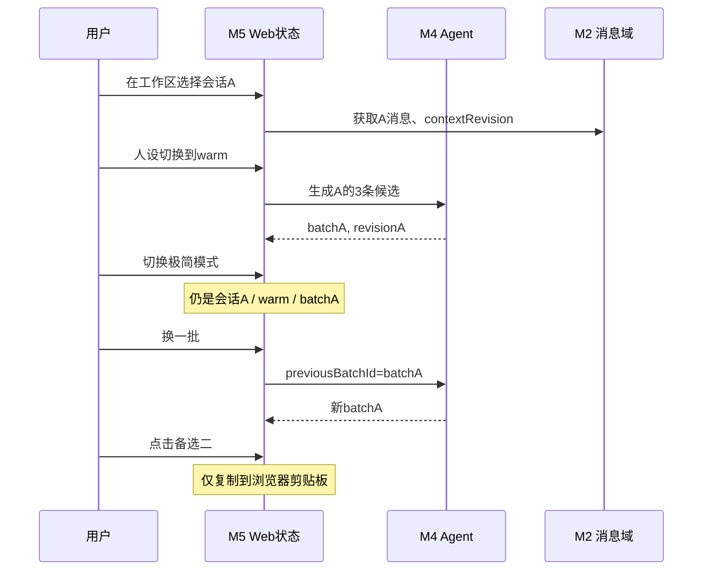

# M5 Web 工作区与极简交互：详细设计

> 2026-10-20 实施更新：本文原有的身份校准横幅和按钮已被《WeChat_Automatic_Sender_Identity_Implementation_Spec.md》取代。Web 展示自动识别结果；`Unknown` 显示发送者未知，不提供互换操作。

> 状态：待评审；以总体架构、Contracts v1 与 V2 HTML 交互原型为产品基线。  
> 特征：**同一 Web 应用中的两种视图**，不是两套业务后端；M5 可以从第一天使用 Mock 开发。

## 1. 目标、典型情境

- 用户在桌面工作区查看当前微信聊天，同时打开 **AI 自由咨询侧边栏**，提问“我想主动找她聊天，有什么自然的话题？”、“这句话怎样理解？”或“我是否应该发出邀约？”；并且能直接在聊天区域看到三条可复制的建议。
- 用户切换至手机分屏/超窄屏时，默认只需要：**展开、备选一、备选二、备选三、预设人设、换一批**。点备选整条复制，回到微信手动粘贴发送。
- 工作区配置账号/会话、微信账号视角选择、历史补录、可维护记忆和 AI/Skill 设置；极简界面不展示这些复杂选项。

## 2. 信息架构与页面分区

### 2.1 工作区（完整模式）

```text
┌──────────── 系统顶部：工作区 / 极简模式切换、连接状态 ────────────┐
│ 功能导航       │ 当前聊天窗口                 │ AI 自由咨询侧边栏 │
│ - 聊天与 AI    │ - 当前账号与会话             │ - 会话绑定提示   │
│ - 接入/会话    │ - 近期消息/方向/时间         │ - 咨询历史       │
│ - 记忆与资料   │ - 三条建议                   │ - 提问输入       │
│ - Agent/Skills│ - 人设切换/换一批/复制      │ - 继续追问       │
│ - 系统状态     │ - 读取更多/补录入口         │ - 证据/不确定性  │
└────────────────────────────────────────────────────────────────┘
```

侧边栏始终显示其当前绑定联系人，切换会话必须切换对应 thread；工作区应同时可以看到聊天原文和 AI 咨询回复，不要求用户来回跳页。

### 2.2 极简模式（严格压缩）

```text
[展开]
[备选一]  ← 整条点击复制
[备选二]  ← 整条点击复制
[备选三]  ← 整条点击复制
[预设人设：点击下一个]   [换一批]
```

默认禁止添加：导航栏、消息列表、AI 对话栏、来源展示、复制独立按钮、微信发送、额外设置卡片。模式退出和会话切换收纳在 `[展开]`。若生成加载/失败，仅在相应位置使用最少的状态信息，不永久增加按钮。

### 2.3 响应式策略

不是只给桌面 UI 缩小字体，而是**按模式主动减少信息密度**。极简默认测 240px、280px、320px、360px 等视口宽度，并测试 400px 左右的有限高度；备选长句必须可以折行，按钮最小可点击面积与滚动高度不能造成误点。工作区在中屏可将侧边栏折叠或纵向排列，但不删除自由咨询能力。

## 3. UI 状态域与唯一数据来源

| 状态 | 数据所有者 | 初始/切换行为 |
|---|---|---|
| `selectedAccountId + selectedConversationId` | M5 UI 选择，M2 授权校验 | 工作区/极简共享；页面重进可以恢复本机偏好，但要重新校验 |
| `activeCaptureTarget` | M1/M6 经服务端管理 | **不会因 UI 选择其它会话而改变**，必要时显式提示“此会话未在实时采集” |
| `messages`、`direction`、`directionEvidence` | M2 | REST 读取 + 通知增量刷新；浏览器只展示持久化方向，不裁定方向 |
| `memoryItems` | M3 | 仅在工作区/展开时按需读取 |
| `personaPresetId` | M5 偏好 + M4 服务端字典 | 两模式共享，轮换按后端启用顺序 |
| `suggestionBatchId + contextRevision` | M4 | 同会话共享；切会话不能复用其它人的批次 |
| `agentThreadId` | M4 | 按会话切换；支持恢复当前联系人的咨询 |
| `isExpanded` | M5 纯本地状态 | 极简默认 false，不影响后端采集/记忆 |

建议一个应用级 `SessionUIState` 管理 `selectedConversation`, `persona`, `currentBatch`，并做按 `accountId:conversationId` 的分区缓存。所有异步响应先检查返回 `accountId + conversationId + requestVersion` 是否仍与目标一致，**绝不能因为慢响应把联系人 A 的候选显示到 B 页面**。

## 4. 工作区交互流程

### 4.1 选会话与聊天刷新

工作区显示账号和联系人目录 → 用户选一个会话 → M2 校验并返回 `ConversationSnapshot + messages` → UI 同步更新聊天、记忆入口、三候选批次和 Agent Thread。若会话未采集，展示可用历史以及清楚的“当前未监听”状态，而非自行切换采集目标。

Web 接收 `message.created` 轻量事件后按游标向 M2 拉取；离线恢复时先调用分页/增量 API 补拉，不能仅靠 WebSocket 消息来保证历史完整。若上下文发生变化，建议区明确“基于较早消息生成”；用户仍可选择复制旧建议。

### 4.2 三条备选

- 未生成：展示明确的“生成建议”入口（工作区允许）；极简若没有可用 batch，备选区显示统一的可触发加载操作或简短提示，而非三条伪造建议。
- 生成中：仅阻止重复提交对应任务，显示轻量加载，仍允许查看现有聊天/旧建议。
- 已完成：三条按服务端顺序显示，整条区域可点击复制；成功反馈“已复制”，失败提示手工选择文本；**永远不显示“已发送微信”**。
- `换一批`：向 M4 发送 `previousBatchId` + 当前人设 + 会话范围；真实请求成功才替换列表，失败仍展示旧批次并提示未刷新。
- `人设切换`：轮换已启用预设，优先取对应人设的有效已生成 batch；没有则请求真实生成或明确提示“需要生成”，不把旧文案硬标成新人设。
- 结果绑定 `contextRevision`；消息补录或已有消息方向从 Unknown 更新为可信值时，旧版本提示过期。

### 4.3 AI 咨询侧边栏

工作区输入或点快捷问题 → 绑定当前 `accountId + conversationId + threadId` 调 M4 `FreeConsultation` → 展示回答、可能的证据来源、运行状态 → 用户继续追问。切会话后自动显示该会话的 Thread 或空白咨询，已在执行的其它会话任务不得覆盖当前视图。

### 4.4 自动发送者方向

聊天消息只呈现 M2 已持久化的方向：本人消息靠右，对方消息靠左；`Unknown` 显示“发送者未知”，不得显示为本人。方向由读取器使用当前账号 wxid 和该消息所在分片解析出的 sender wxid 自动计算。此处没有逐会话确认或互换身份的操作。

账号 wxid 还未绑定时，页面显示账号身份未识别状态；不能将短 sender ID 或联系人显示名当作方向。已落库旧消息只有在来源记录重读取得可信 sender wxid 后才会改变方向；它们不会由 Web 页面回算。

### 4.5 历史补录入口

工作区当前会话的“同步历史”操作 → 显示明确受限范围（基础版 Text / Direct / 当前账号会话），经用户确认 → M1 生成 HistoryJob → 显示读取/匹配/新增/待核对计数及失败原因。`Completed` 表示**这次有界扫描完成**，不是所有微信历史已完整。

### 4.6 配置页面

工作区保留：接入状态与采集目标、会话、方向识别状态、联系人记忆 CRUD、Agent Runtime/Skill/预设人设、系统状态和错误。首版对大部分复杂项可以由后端固定配置，前端只展示可实际工作的开关和状态，不做大量暂不能实现的配置控件。

## 5. 需要后端提供的 API（按模块）

| 功能 | 对应模块 | 关键合同 |
|---|---|---|
| 账号/会话目录、消息分页/游标 | M2 | `ConversationSnapshot`、`NormalizedMessage`、`messageCursor` |
| 采集状态、采集目标、历史任务 | M1/M6 | ReaderStatus、HistoryJobStatus，不混淆 UI 选择 |
| 方向识别结果 | M2 | 按持久化 `direction`、`directionEvidence` 显示本人/联系人/未知 |
| 画像/记忆沉淀状态 | M3 | `profileStatus`、未沉淀文本字符数、5,000 字阈值、共享游标及当前 `calibrationVersion` |
| 可维护记忆 | M3 | MemoryItem、版本/来源/证据、CRUD |
| 生成与换批候选 | M4 | AgentTaskV1、SuggestionBatchV1、旧批次查询 |
| Agent 咨询与线程 | M4 | ConsultationTurnV1、线程归属校验 |
| 轻量事件 | M2/M6 | `message.created`、`conversation.perspective-confirmed`、Agent 状态 |

**接口可立即 Mock：** 使用共享 JSON fixtures 而非在组件内部自定义一次性 DTO。前端路由、缓存、异步并发/过期处理要和 Mock API 同样严格。

## 6. 工作区与极简共享状态时序



## 7. 易错点与异常状态

- UI 在生成时切换会话：旧请求可以完成但要写入旧会话的缓存，不得出现在新会话。
- 浏览器剪贴板权限失败：明确提示选择复制；不触发任何微信 API。
- 断网、数据服务重启：显示服务状态，恢复后按 cursor 查询，不能重复追加同一消息 DOM。
- 未知方向：工作区显示“发送者未知”，不能把该消息画成本人发言或作为可信风格证据。
- SourceConfirmed 消息方向变化会使依赖方向的上下文与建议 batch 标旧版本。
- 任务耗时较长：保留旧结果并显示新任务进度；支持取消 UI 请求，不假装后端一定已取消。
- 手机浏览器后台挂起：恢复时重新同步 Web 选择状态与 M2/M4 数据，不依赖浏览器持续在线。

## 8. 子任务与并行实施

1. **M5-A（S0 立即）**：产品壳、模式切换、工作区聊天双栏/AI 咨询栏布局、超窄极简六元素；继承 V2 HTML 原型的交互约束。
2. **M5-B（S0 立即）**：状态模型、会话隔离、防旧响应串话、人设和当前 batch 管理；使用 Contracts v1 fixture。
3. **M5-C（S1 并行）**：Mock API 实现与端到端 UI 测试：消息列表、候选复制、换批、线程咨询、展开。
4. **M5-D（M2/M4 接口可用后）**：真实 REST 与消息通知联调，自动方向显示及 Unknown 提示、共享画像/记忆沉淀状态与字符计数、记忆 CRUD 和历史任务状态接入。
5. **M5-E（S2）**：真机窄屏/分屏、人设切换、加载/失败/复制权限反馈回归。

## 9. 交付与验收

| 编号 | 验收条件 |
|---|---|
| M5-T01 | 工作区同屏能看聊天和 AI 咨询侧边栏，完成至少两轮模拟问答 |
| M5-T02 | 极简默认只有 `[展开]`、3 条备选、人设、换一批；没有独立发送按钮 |
| M5-T03 | 240px 等窄视口不产生横向溢出，长候选可读且整条可复制 |
| M5-T04 | 工作区 → 极简 → 工作区保留同会话、人设和有效批次 |
| M5-T05 | 切换联系人期间旧 AI 任务晚到不污染新会话；Thread 不串联系人 |
| M5-T06 | 点击换一批发真实任务，失败保留旧 batch 并给错误反馈 |
| M5-T07 | 人设切换到无缓存预设不会把旧内容冒充新预设 |
| M5-T08 | SourceConfirmed 消息按持久化方向正确绘制；Unknown 消息显示发送者未知 |
| M5-T09 | 账号 wxid 未识别时不将未知消息显示为本人或注入本人风格记忆 |
| M5-T10 | 多分片相同 `localId` 保留为两条消息，Web 不依赖会话校准 |
| M5-T10a | 未沉淀字符 5,000 时显示累积；达到 5,001 后显示沉淀中及共享画像/记忆批次状态 |
| M5-T11 | 通知断开/重连后，消息按服务端 cursor 正确补拉 |
| M5-T12 | 复制成功/失败反馈正确；任何路径均不调用微信发送 |

**完成定义：** 真实 API 上的工作区双栏 + 超窄极简六元素完成基础交互闭环。高阶 PWA 通知、自动检测微信前台联系人、网页代发微信不属于首版。
