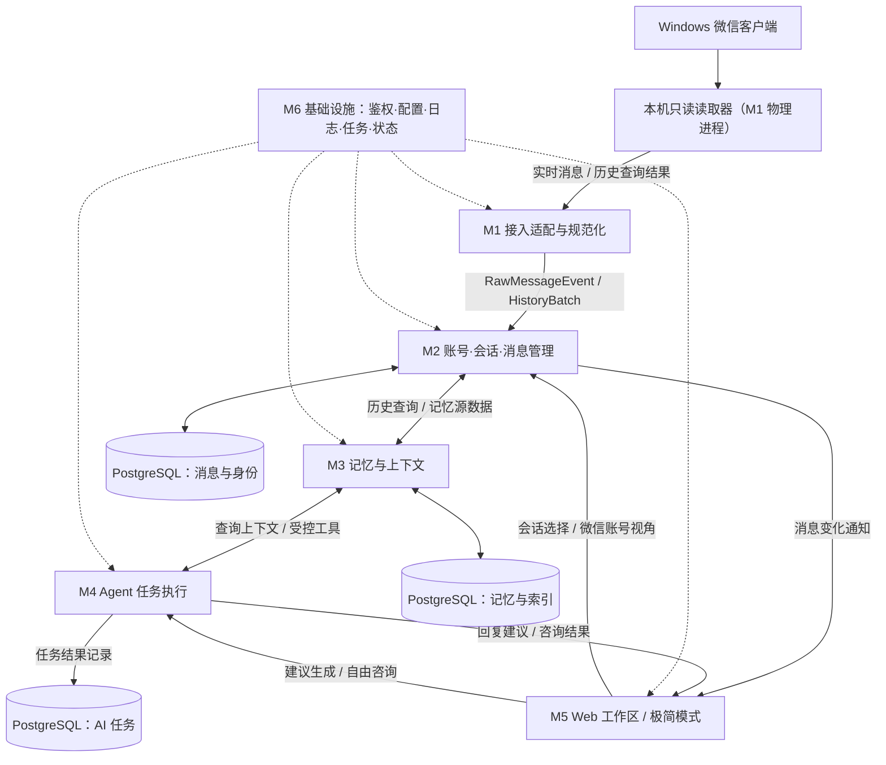
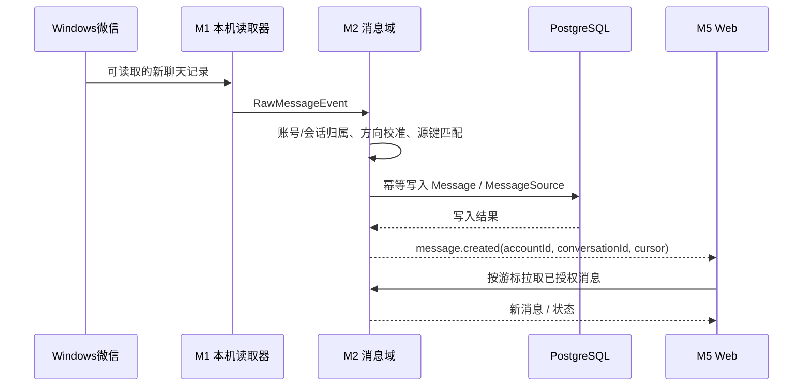
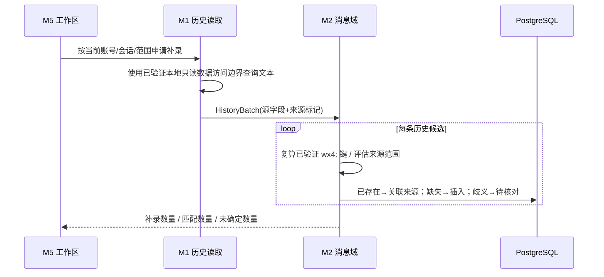
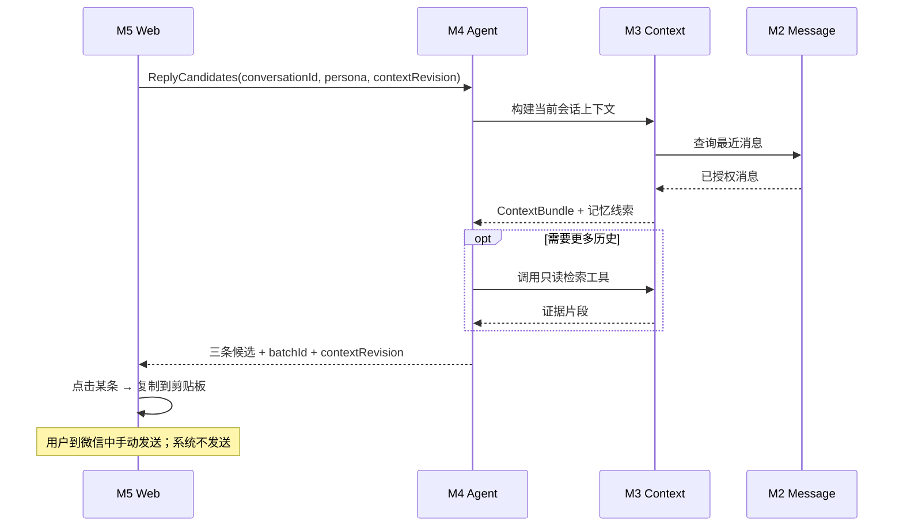

# 微信 AI 沟通助手：总体架构与模块边界设计

> 2026-10-20 实施更新：本文原有的短 sender ID 默认视角和人工确认流程已被《WeChat_Automatic_Sender_Identity_Implementation_Spec.md》取代。当前方向基于账号 wxid 与消息所在分片内的 sender wxid；不可解析时保持 `Unknown`。

> **文档版本：** 1.0-Draft（总体设计，供独立评审与模块详细设计使用）  
> **编写日期：** 2026-10-09  
> **阶段：** 核心技术 POC 已完成限定范围验证；开始正式架构设计  
> **设计定位：** 个人自用、微信只读采集、长期联系人记忆、AI 辅助建议与自由咨询  
> **本文不承担：** 六个模块的详细数据库 DDL、全部接口实现细节、UI 像素级稿件、正式代码开发任务书

---

## 0. 阅读说明与事实边界

本文以用户已确定的产品形态、既有实时消息 POC、历史补录 POC 和 Web 交互原型为基础。其中应严格区分以下三种表述：

- **已验证（Verified）**：现有测试报告中有真实执行证据，且仅在写明的样本和环境内成立。
- **架构决策（Decision）**：本设计提议固定的模块边界、数据契约和实现约束，尚不代表代码已实现。
- **预留 / 待细化（Planned）**：未来功能和可能扩展方式，不能当作基础版已经支持的能力。

### 0.1 已验证的技术基础

| 能力 | 已有证据 | 界限 |
|---|---|---|
| 个人微信普通一对一消息读取 | Windows 微信 + 本地只读读取器可捕获真实消息 | 非官方本地数据读取路径，依赖客户端与读取器可运行 |
| 手机微信本人发送、联系人发送的消息进入系统 | 已有真实双向 canary，经 PostgreSQL 存储及 Web 展示 | 方向校准仅在有明确身份映射的作用域有效，旧行可能仍为 `Unknown` |
| 后端存储与 Web 实时刷新 | ASP.NET Core + PostgreSQL + WebSocket/SignalR 思路对应的既有 POC 链路已验证 | 不等于生产级可持续运行、跨网络部署已验证 |
| 只读历史查询 | 当前 Windows 微信 `4.1.15.13`，单账号、一个普通会话、单分片文本历史查询成功 | 未验证全部联系人、跨分片、全部消息类型 |
| 历史与实时消息 ID 映射 | 5/5 实时 canary 可由历史原始字段重算出相同 `wx4:` ID | 现有公式未包含来源 shard，不能推出跨分片全域唯一 |
| 补录幂等 | 隔离 PostgreSQL 中缺失消息写入、重复输入不重复、同文异 ID 不误合并均通过 | 尚未实现正式同步服务或正式库写入流程 |
| 工作区/极简模式 | 已有单文件 HTML 交互原型供产品讨论 | 属于模拟前端，不是生产版 UI 或真实 AI 调用 |

**本设计不将 72 小时运行、多会话同时监听、跨分片 ID 处理、系统级真机分屏、真实 Agent 效果等写为“已验证”。** 这些属于后续实施与演进，不反向阻塞总体设计。

### 0.2 参考材料

- [P0 实测报告](../../../../poc-reference/docs/poc/feasibility-report.md)：实时采集、方向校准和 Web POC 实测。
- [本机读取器说明](../../../../poc-reference/docs/poc/local-reader-integration.md)：读取器的能力、身份范围和限制。
- [历史补录 POC 报告](../../../../poc-reference/docs/poc/history-backfill-poc-report.md)：H01–H08 实测与 Go 范围。
- [历史来源字段映射](../../../../poc-reference/docs/poc/history-backfill-source-mapping.md)：实时与历史字段、消息 ID 的实测映射。
- [历史导出源码调研报告](../../research/WeChat_History_Exporter_Research_Report.md)：旧历史导出项目的源码调研；不等于当前读取器的实测。
- [交互原型](../prototypes/wechat_ai_ui_prototype_v2.html)：工作区、AI 咨询栏、极简分屏模式和微信账号视角选择的产品参考。

> 说明：本设计包引用的是仓库内已经记录的报告事实，没有在编写本设计时重新运行读取器、访问私人仓库或重新检验真实微信账号。实时消息/方向 POC 使用微信 4.1.12.26；历史补录 POC 使用微信 4.1.15.13，二者是分开的测试证据。

---

## 1. 产品目标与边界

### 1.1 一句话目标

**不改变用户使用微信聊天的习惯，持续积累指定联系人的聊天上下文，并在 Web 工作区或极简分屏窗口中，通过可切换的人设和 Agent 咨询提供可复制的沟通建议。**

### 1.2 首个可用基础版应完成的闭环

1. Windows 微信保持正常登录，本机只读读取器观察用户指定的一对一会话。
2. 双向文本消息标准化、去重、按账号与会话归档至 PostgreSQL。
3. 用户可在 Web 工作区查看对应聊天，并为选定微信账号/会话选择本人视角，让界面标明哪一侧属于该微信登录账号。
4. AI 基于当前会话近期消息，以及已有的可用长期信息，返回 **3 条候选建议**。
5. 用户可选择预设人设、换一批建议；点击候选内容即复制，继续在微信中**手动发送**。
6. 用户还可以在工作区的 **AI 咨询侧边栏**，就当前联系人主动找话题、分析聊天、权衡沟通选择等进行多轮交流。
7. 在需要时，用户可对指定会话发起**受限的文本历史补录**，以改善上下文覆盖；不要求先完成全量历史导入。

这里的“长期记忆”首先是**消息证据长期留存 + 可检索的历史上下文 + 少量可维护的联系人记忆**，不把自动人格推断、图谱、复杂反馈学习列为首版前置条件。

### 1.3 明确不做的事情

- **不提供微信消息主动发送、自动回复、撤回、已读控制或登录代操作。**
- 不要求机器人账号替代本人账号参与聊天。
- 不要求所有联系人后台同时监听；基础版可只采集当前已明确启用的一个会话。
- 不要求自动识别手机微信当前正在打开的联系人；Web 手动选择。
- 不要求导出多年聊天记录、补齐本地不存在的消息、支持所有媒体类型。
- 不要求一个 Agent 同时管理微信连接、数据库、记忆和系统配置。
- 不预先引入微服务集群、Neo4j、消息队列或多 Agent 协作。

### 1.4 基础版与增强能力

| 领域 | 基础版（优先设计/实施） | 后续增强（仅预留） |
|---|---|---|
| 采集 | 一个允许的微信账号、一个被启用的普通一对一会话、只读文本 | 多会话并行监听、跨账号、群聊、多类型附件 |
| 历史 | 当前会话按需文本查询/补录；按已验证源键幂等 | 批量增量对账、多分片、断点恢复、全量导入 |
| 方向 | 两个可分离的数字原始 sender ID；初始化默认小 ID 为本人但须用户确认；“互换身份”仅预览，“确认身份”才提交 | 超出账号/会话/身份范围的自动映射 |
| 记忆/画像 | 保存历史消息、人工记忆及已确认视角下的账号/联系人画像摘要；AI 任务时自动加载，画像和自动长期记忆共用 >5,000 字增量沉淀窗口 | 定时更新、手动强制刷新、事件时间线、复杂画像/性格推断、语义向量索引与冲突修订 |
| AI | 3 个回复候选、人设预设、换一批、工作区 Agent 自由问答 | 自动触发、反馈学习、多模型路由、更多工具 |
| Web | 完整工作区 + 极简小屏模式 | 自动切换联系人、通知/PWA、更多数据可视化 |
| 运维 | 单用户认证、基本状态/错误、必要的数据保护 | 长期监控、告警、高可用、备份自动化 |

**“增强”表示实现顺序，不是技术上必须拆成另一套系统或产品收费版本。**

---

## 2. 顶层架构决策

### 2.1 采用模块化单体，不采用六个微服务

系统划分为 **6 个逻辑模块**，以及一份统一的总体契约：

1. **M1 微信接入与消息采集**（WeChat Acquisition）
2. **M2 账号、会话与消息管理**（Conversation & Message Domain）
3. **M3 AI 记忆与上下文**（Memory & Context）
4. **M4 Agent 任务执行**（Agent Runtime & Recommendation）
5. **M5 Web 工作区与极简交互**（Web Experience）
6. **M6 基础设施与系统管理**（Platform & Operations）

**建议物理部署边界：**

- **Windows 本机采集进程**：复用现有 Python/读取库的只读路径，属于 M1 的物理实现。
- **ASP.NET Core 模块化单体**：M1 的接入 API / 管理接口 + M2 + M3 + M4 的业务编排 + M6 公共能力。
- **PostgreSQL**：一个物理数据库，通过模块所有权分清数据表和访问边界。
- **Web 前端**：M5，提供完整工作区与极简模式。
- **可选独立 Agent Runtime 进程**：只有选用 Codex CLI 等需要独立运行环境的 Harness 时才增加；不是第七个业务模块。

这样能减少开发和部署复杂度，同时为本机读取器和 Agent 执行环境保留明确隔离。

### 2.2 逻辑模块关系图



> 图中的三个 PostgreSQL 节点表示**同一物理数据库中的不同逻辑数据域**，不是三个数据库实例。M1/M2/M3/M4 之间的箭头是契约关系，不意味着全部通过 HTTP 通信。

### 2.3 两个正交维度：采集选择与 UI 当前会话

- `ActiveCaptureTarget`：采集端当前被允许读取并正在监听的账号/会话。
- `SelectedConversation`：当前 Web 工作区/极简模式正在查看和咨询的账号/会话。

在基础版中，两者可以被同一操作设置为相同目标；**数据模型、接口契约上必须区分**。否则未来增加多会话监听时，会因为 UI 切换而改变采集状态，导致数据缺口。

### 2.4 人工控制边界

- 用户最终在微信中发送消息；任何 AI 输出都只是**建议**。
- 对同一账号/会话/身份命名空间里恰好两个可比较的非负数字 sender ID，初始化默认较小 ID 为目标微信账号本人并记录为待确认视角；工作区“互换身份”只改变待确认预览，“确认身份”才提交选择。待确认期间不更新画像/自动长期记忆；首次确认后才启动第一次沉淀。此为可逆默认规则，不是已证明的跨账号事实。
- Agent 可以通过工具**查询**当前授权账号/会话的历史与记忆；不能直接访问数据库凭据、微信读取器或发送接口。
- 记忆的可见事实与证据仍由业务系统管理，不由 Agent 会话历史替代。

---

## 3. 六大模块职责与边界

### M1. 微信接入与消息采集

**职责：** 获取可访问的微信原始消息与读取器运行状态，向系统提供来源明确的标准事件；按需受理历史查询请求。

- **拥有**：读取器集成、采集运行控制、本地源身份、采集水位/状态、原始消息提取适配。
- **对外输出**：`RawMessageEvent`、`HistoryBatch`、`ReaderStatus`。
- **输入**：授权的账号和采集目标、历史查询范围、暂停/恢复命令。
- **禁止承担**：决定人物关系、生成 AI 回复、持久化人物画像、让微信发送消息。
- **基础版实现**：复用 Windows 微信本机只读读取器，仍按用户指定的普通会话工作。
- **增强预留**：多目标采集、更多来源适配、复杂附件与不同微信版本兼容。

**模块关键边界：** 微信私有数据库表、分片命名、压缩字段等细节只留在 M1；其它模块不依赖微信源表结构。

### M2. 账号、会话与消息管理

**职责：** 将事件关联至正确账号/会话，保存规范化消息、来源证据和身份校准；为其它模块提供权限受控的聊天查询。

- **拥有**：`Account`、`Conversation`、`Message`、`MessageSource`、`SenderCalibration`、消息匹配/去重规则。
- **输入**：M1 的新消息与历史批次；M5 的会话选择、微信账号视角选择、查询请求。
- **输出**：`NormalizedMessage`、`ConversationSnapshot`、查询分页、消息变化事件。
- **禁止承担**：自己解析微信数据库、自动推断关系画像、处理 Agent 循环。
- **关键原则**：`账号 + 会话` 必须进入每条消息和每次查询的作用域，昵称不作为稳定身份键。

**历史与实时数据在 M2 汇合**，避免分别构建两套消息库。

### M3. AI 记忆与上下文

**职责：** 基于消息证据提供近期上下文、历史检索和长期记忆，并给 M4 提供可追溯的查询服务。

- **拥有**：`MemoryItem`、`ParticipantProfileSnapshot`、记忆来源/状态、上下文构建策略、检索抽象。
- **输入**：M2 提供的已归档消息；用户修正/补充的联系人记忆；M4 的只读工具查询。
- **输出**：`ContextBundle`、记忆查询结果、来源引用。
- **基础版**：最近消息、按会话/时间/关键词查询、人工记忆，以及等待用户确认视角后才生成/刷新的证据型账号与联系人摘要。
- **增强**：复杂事件抽取、向量检索、冲突修订、相关性评估、自动心理/人格推断。
- **禁止承担**：自行重分类微信发送者、隐式修改原始消息、替 Agent 生成最终沟通建议。

记忆项需要指向证据消息或明确的用户输入；`Unknown` 方向不能作为确定的“本人表达风格”依据。

### M4. Agent 任务执行

**职责：** 运行用户主动发起的 AI 任务，按需读取上下文与记忆，返回回复候选或自由咨询结果。

- **拥有**：`AgentTask`、`AgentRun`、`SuggestionBatch`、`AgentConversation`、Skill/Prompt 配置、Agent Runtime 适配接口。
- **两种首要任务**：
  - `ReplyCandidates`：针对当前会话生成 3 条备选回复，可按人设重生成。
  - `FreeConsultation`：围绕当前联系人自由问答，如主动找话题、理解对方表达、沟通决策。
- **可选 Runtime**：Codex CLI + Skill + 只读工具；或后续评估的托管 Agent 服务/模型 API。**当前不锁定最终 Harness**。
- **只读业务工具**：近期消息、历史搜索、联系人记忆与来源查询。工具调用在业务侧校验账号和会话范围。
- **禁止承担**：微信收发、数据库迁移、直接修改消息记录、未经审查写入正式长期记忆。

简单建议可直接使用预构建上下文调用模型；复杂问题再允许 Agent 自主检索。是否每个任务都由 Codex 处理，留给 M4 详细设计和评估。

### M5. Web 工作区与极简交互

**职责：** 将用户可见的聊天辅助操作组合为两个共享状态的界面模式，不拥有长期业务真相。

**工作区（完整模式）包含：**

1. 当前账号、联系人和会话选择。
2. 中央**聊天窗口**：展示消息、时间、方向和采集状态。
3. **回复建议区域**：三条候选、选择人设、换一批、复制。
4. **AI 自由咨询侧边栏**：绑定当前会话，支持多轮咨询、主动找话题、聊天分析与决策讨论。
5. 工作区设置入口：接入、会话、微信账号视角选择、记忆管理、Agent/Skill 设置、系统状态。

**极简模式（手机分屏 / 超窄屏）默认只显示以下元素，按此顺序：**

```text
[展开]                         （其它内容默认隐藏）

[备选一]                      （整条点击复制）
[备选二]                      （整条点击复制）
[备选三]                      （整条点击复制）

[预设人设：点击切换下一个]    [换一批]
```

- 极简模式不展示完整聊天记录、AI 咨询栏、配置菜单和独立发送按钮。
- `展开` 中可显示当前联系人、最近聊天和进入完整工作区入口。
- “换一批”是新一组候选回复，不能只在前端伪装换词；正式版应调用 M4 或读取已生成的其它 batch。
- 工作区和极简模式必须共用同一 `SelectedConversation`、当前人设与候选批次；避免切换模式后用错联系人。
- 用户点击候选只发生**复制**操作，不能触发微信发送 API。

### M6. 基础设施与系统管理

**职责：** 提供跨模块的认证、配置、日志、运行状态、任务调度、存储连接与数据安全机制。

- **基础版**：单用户安全访问、配置/密钥管理、日志脱敏、简单健康状态、错误反馈、数据库迁移、Agent 运行时隔离。
- **后续增强**：自动备份、性能指标、任务队列、告警、细粒度权限、多设备同步。
- **禁止承担**：将所有业务判断塞进通用配置与工具层。

**M6 是横向支撑模块；不要把所有模块拆成独立基础设施服务。**

### 3.1 模块所有权总表

| 数据 / 行为 | 唯一责任模块 | 允许访问者 | 不允许的耦合 |
|---|---|---|---|
| 微信原始字段与采集状态 | M1 | M2、M6 | M3/M4 直接查询微信源数据库 |
| 账号、会话、标准消息 | M2 | M3、M5、M4 经工具访问 | M4 自己写消息表 |
| 消息来源与身份校准 | M2 | M1 提供原始来源，M5 选择目标微信账号视角 | 前端用全局 sender 数值判断本人 |
| 联系人记忆 / 上下文 | M3 | M4、M5 经 API | Codex 本地文件成为唯一记忆库 |
| AI 任务 / 建议批次 / 咨询记录 | M4 | M5、M6 | M1 直接触发任意 Agent 工具 |
| UI 当前模式、展开状态 | M5 | M5 | UI 当前会话选择等同于采集订阅 |
| 凭据、审计、运行配置 | M6 | 按需授权的模块 | Agent 读取明文微信凭据 / 全库数据库密码 |

---

## 4. 跨模块数据流：需要协调的主要契约

### 4.1 核心交流清单

| 编号 | 数据流 | 类型 | 关键字段/约束 | 触发方式 |
|---|---|---|---|---|
| D01 | M1 → M2：实时消息事件 | 写入 | 账号、会话、原始身份、文本、时间、来源键 | 读取器观察到新消息 |
| D02 | M1 → M2：历史查询批次 | 批量写入 | 同 D01 + 批次、源分片、原始 ID、查询范围 | 用户点击历史补录 |
| D03 | M5 → M2：账号与会话选择 | 查询/状态更新 | 账号 ID、会话 ID、用户权限、UI 状态 | 用户选择 |
| D04 | M5 → M2：选择微信账号视角 | 用户命令 | 校准作用域、修订版本、当前账号本人 sender ID | 用户选择 |
| D05 | M2 → M3：读取近期/历史消息 | 查询 | 当前账号、当前会话、范围与权限 | AI 任务或查看记忆 |
| D06 | M3 → M4：上下文与工具结果 | 只读查询 | `ContextBundle`、证据定位、可用性标记 | 模型/Agent 按需调用 |
| D07 | M5 → M4：生成候选 | 异步/同步任务 | 当前会话、人设、上下文游标、任务类型 | 用户生成/换一批 |
| D08 | M4 → M5：候选列表 | 返回结果 | 3 条建议、批次 ID、依据的上下文版本 | 任务完成 |
| D09 | M5 ↔ M4：自由咨询 | 多轮任务 | 联系人绑定、用户问题、线程 ID、回答 | 工作区侧边栏问答 |
| D10 | M2 → M5：消息/会话刷新 | 实时通知 | 账号、会话、消息游标；正文按需拉取 | 消息成功落库后 |
| D11 | M6 ↔ 各模块：运行状态与鉴权 | 管理 | 用户身份、账号范围、错误码、健康信息 | 全生命周期 |

**必须先定稿的跨模块契约为 D01、D02、D04、D06、D07、D08、D09、D10。** 这些一旦含义混乱，会同时影响后端、Agent 和前端。

### 4.2 事件与请求示例（规范草案，非现有 API）

**RawMessageEvent / 历史行规范化输入：**

```json
{
  "schemaVersion": 1,
  "provider": "local-wechat",
  "sourceKind": "Realtime",
  "accountExternalId": "test-account",
  "conversationExternalId": "test-contact",
  "conversationType": "Direct",
  "messageType": "Text",
  "text": "测试文本",
  "sourceOccurredAt": "2026-10-09T02:00:00Z",
  "rawSenderId": "73",
  "sourceIdentity": {
    "localId": 58,
    "sortSeq": "example-seq",
    "serverId": null,
    "shardFingerprint": null,
    "messageTable": "example-table"
  },
  "direction": "Unknown",
  "directionEvidence": "unresolved"
}
```

要求：

- 上述示例是**自定义传输契约**，不是微信/读取库原始事件结构。
- `sourceKind` 为 `Realtime` / `HistoryBackfill`；与 `provider` 分离。
- 源 ID 缺失应为 `null`，不要发明 ID；`sortSeq` 类型在具体实现阶段以读取器真实精度/格式为准。
- `direction` 取 `Incoming` / `Outgoing` / `Unknown`；不允许模型通过措辞猜测。
- M2 生成稳定内部 `messageId`，不把原始 `wx4:` ID 当成所有数据源通用 ID。

**上下文请求：**

```json
{
  "accountId": "internal-account-id",
  "conversationId": "internal-conversation-id",
  "anchorMessageId": "internal-message-id-or-null",
  "recentMessageLimit": 30,
  "includeMemory": true,
  "requestPurpose": "ReplyCandidates"
}
```

**Agent 任务：**

```json
{
  "taskType": "ReplyCandidates",
  "accountId": "internal-account-id",
  "conversationId": "internal-conversation-id",
  "personaPresetId": "natural",
  "previousBatchId": null,
  "threadId": null,
  "userInput": null,
  "contextRevision": "last-message-cursor-or-snapshot-version"
}
```

- 任务类型允许 `ReplyCandidates` 和 `FreeConsultation`，前者期望 3 条候选，后者期望咨询答复。
- `userInput` 只对自由咨询有效；不能从客户端随意传入其它联系人的私密上下文。
- Agent 返回的证据应指向受控的消息/记忆 ID，不应直接要求前端执行任意工具命令。

**建议结果：**

```json
{
  "runId": "run-id",
  "taskType": "ReplyCandidates",
  "conversationId": "internal-conversation-id",
  "personaPresetId": "natural",
  "contextRevision": "last-message-cursor-or-snapshot-version",
  "batchId": "batch-id",
  "suggestions": [
    {"id": "s1", "text": "建议一"},
    {"id": "s2", "text": "建议二"},
    {"id": "s3", "text": "建议三"}
  ],
  "status": "Completed"
}
```

- 若上下文在生成期间变化，旧批次仍可查看，但 Web 应提示“基于较早上下文生成”。
- “换一批”请求携带上次 `batchId`，便于模型知道希望变化，但不承诺每次必然完全不同。
- 复制行为由 M5 完成，不反馈为“微信已经发送”。

**消息变更通知：**

```json
{
  "event": "message.created",
  "accountId": "internal-account-id",
  "conversationId": "internal-conversation-id",
  "messageCursor": "cursor"
}
```

Web 收到通知后可通过 REST 增量拉取，断线恢复同样使用游标补拉；通知事件可以不携带聊天正文。

---

## 5. 核心实体与存储边界（概念模型）

以下是**概念实体**，不是最终数据库表清单或 DDL。多个实体可在基础版中合并物理表，但业务语义不得混淆。

| 实体 | 拥有模块 | 用途与关键关系 |
|---|---|---|
| `ChatAccount` | M2 | 微信接入账号身份；对会话、消息和工具查询定界 |
| `Contact` | M2 | 联系人身份与显示信息；昵称不是稳定键 |
| `Conversation` | M2 | 账号内的具体一对一会话；用于所有消息与 AI 线程归属 |
| `Message` | M2 | 规范化消息、正文/类型、方向、源时间、内部主键 |
| `MessageSource` | M2 | 同一逻辑消息的实时/历史来源证据、外部 ID、分片指纹、原始字段 |
| `SenderCalibration` | M2 | 待确认的小 ID 默认映射或用户确认的 sender 映射，含状态/证据/作用域/版本 |
| `CaptureTarget / CaptureState` | M1/M6 | 采集目标、最后观察事件、运行状态；不等同于 UI 选择 |
| `HistorySyncJob` | M1/M2 | 补录请求、范围、计数、审计与未确定记录 |
| `MemoryItem` | M3 | 可维护的长期信息、联系人/会话范围、证据、有效性 |
| `ParticipantProfileSnapshot` | M3 | 账号/联系人的可重建画像摘要、证据消息游标、视角版本与沉淀状态 |
| `AgentTask / AgentRun` | M4 | 执行历史、任务状态、耗时/错误及关联会话 |
| `SuggestionBatch / Suggestion` | M4 | 3 个候选、预设人设、上下文版本、批次与复制选择信息 |
| `AgentConversation / AgentTurn` | M4 | 当前联系人绑定的自由咨询线程，不替代长期记忆库 |
| `UserPreferences / PersonaPreset` | M5/M6 | 当前预设、UI 偏好、预设描述与默认行为 |

### 5.1 消息源 ID 设计：不能只留一列

目前的实测来源键逻辑为：

```text
wx4: + SHA256(account | conversation | local_id | sort_seq)
```

**实测边界：** 历史行重算的 `wx4:` ID 与 5/5 既有实时 canary 完全匹配；单会话、单 shard 的 92 条历史文本没有发现冲突。不能把这个结果扩展成“全部消息全局唯一”。

建议：

1. `Message.Id` 使用独立内部主键。
2. `MessageSource` 同时记录 `sourceKind`、`provider`、已验证的 `liveExternalMessageId`、`serverId`、`localId`、`sortSeq`、`shardFingerprint`、账号/会话作用域。
3. **保持旧 POC 键兼容**：不为“看起来更完美”而随意改写已有外部 ID。未来如引入更完整的复合源键，采用**版本化匹配策略 + 来源关联映射**迁移。
4. 只有证据确凿的相同源键才能自动合并；跨分片冲突或缺少身份字段时标为 `NeedsReview`。
5. **禁止正文相同 + 时间接近就合并**，因为真实聊天可能连续发送两条完全一样的内容。

### 5.2 发送方向与账号视角模型

产品交互（针对身份范围明确且恰好有两个可比较原始发送者的一对一会话）：

```text
初始化：较小 raw sender ID 暂记为这个微信登录账号本人（PendingConfirmation）
用户操作：互换身份仅预览 → 确认身份提交当前预览
系统派生：已确认 sender → 当前账号视角，另一个 sender → 会话联系人
```

系统初始化时把同一有效范围内较小的数字 sender ID 记为当前采集的微信登录账号本人，状态为 `PendingConfirmation`；界面必须标为“默认，待确认”。“互换身份”只把另一侧切换为预览中的本人候选，不持久化、不重投影、不触发画像；用户点“确认身份”才提交当前选择。POC 样本中，原账号的本人 ID 为 1、联系人为 73，而测试好友账号的本人 ID 为 2、对端为 1；这说明默认规则在后一账号上会反向，互换是纠正误判所需入口。选择对象始终是当前采集的微信账号，不是使用 Web 的人。

- 视角作用域至少包含 `AccountId + ConversationId + identityNamespace`；当前本地读取器还需 `messageTable + shardFingerprint`。默认比较只接受可无损解析为非负十进制整数的两个不同 ID；不得用字符串字典序比较。
- 恰好两个可比较 ID 时，默认记录 `DefaultSmallSenderId` 并投影临时方向。相同 ID、非数字 ID、多方冲突或无法确定作用域时保持 `Unknown`。
- 用户点“确认身份”时，写入明确的本人 `rawSenderId`，产生新 `UserConfirmed` 版本。后续读取器刷新不得把用户确认重置为小 ID 默认值；**不要修改源消息原始身份字段。**
- 待确认期间不建立或更新参与者画像及自动消息记忆。首次确认视角后，M3 立即执行初始沉淀；再次换视角须先互换预览、再确认，旧版本画像/自动记忆立即失效并按新映射重建，人工维护记忆不变。
- 其它账号/会话/分片的 sender ID 即使数字相同，也不能未经证据跨域沿用。
- 冲突/单方缺失/多于两种身份等情况保持 `Unknown`，交由后续详细设计处理。

### 5.3 记忆数据与原始证据分离

- `Message` 是历史证据；`MemoryItem` 是从证据或明确人工输入产生的可维护知识。画像主体是微信参与者（微信登录账号或联系人），不是当前 Web 登录用户。
- 账号本人和联系人是两个不同的画像主体；视角确认只决定消息归属投影，不改变画像主体身份。待确认或方向未知时，消息可用于中性检索，但不能分配到任何一方的风格画像。
- 记忆应记录 `sourceMessageIds`、`observedAt`、`updatedAt`、`status` 等基本信息。
- 用户确认 sender ID 前不生成、更新或向 AI 提供任一参与者画像/自动消息记忆；确认后首次沉淀立即执行。之后按 `account + conversation + identityNamespace + calibrationVersion` 共用未沉淀文本窗口，累计严格超过 5,000 Unicode 字符时一次性生成画像增量和消息抽取长期记忆，成功后推进同一来源游标；没有日历定时任务或手动强制刷新。
- 沉淀只使用 M2 已存消息，不隐式触发历史补录。每批自动生成内容都保存证据、游标和视角版本，不覆盖人工 `MemoryItem`；失败不推进游标，使用同一范围幂等重试。
- AI 每次生成建议或开始咨询时加载当前版本的画像与人工记忆，不因单纯打开页面调用模型；视角变更后旧画像立即退出上下文并按新映射重建。
- 记忆修正、过期或删除，不意味着篡改原始聊天记录；用户主动删除应有独立机制。
- 自由咨询 Thread 是任务上下文，不是长期记忆的唯一存储。

---

## 6. 关键业务流程

### 6.1 流程 A：实时消息 → 工作区聊天展示



**约束**：实时通知只能发生在可靠持久化之后；页面刷新不能把 UI 当前会话切换成另一个联系人。

### 6.2 流程 B：历史补录 → 与现有消息合并



**边界**：基础版按指定会话执行，初步只支持文本、受限批次；不把“只补不删”等同于“永远完整”。该流程可先作为工作区手动命令，后续再实现定时同步。

### 6.3 流程 C：生成三条备选 → 极简模式复制



“换一批”重走或复用对应生成流程；“人设切换”改变随后生成任务的预设。如何缓存不同人设的候选由 M4 详细设计。

### 6.4 流程 D：工作区侧边栏多轮 AI 咨询

1. 用户当前选中账号 A / 联系人 B，在工作区输入：“我很无聊，想主动给她发消息，找什么话题？”
2. M5 向 M4 传 `FreeConsultation`，附当前绑定的 `ConversationId`、`ThreadId` 和用户输入。
3. M4 从 M3 获取近期消息与已知记忆；必要时动态调用受控历史检索工具。
4. M4 返回分析、话题建议或不确定性；用户可以继续追问，Thread 仍与该会话绑定。
5. 用户切换至联系人 C 时，**不能把 B 的自由咨询线程或记忆自动带入 C**。切回 B 可按需恢复 B 的线程。
6. 咨询结果不自动写进联系人事实，更不直接操作微信。

### 6.5 流程 E：用户选择微信账号视角

1. M5 在作用域满足条件时显示默认方向：较小的数字 sender ID 为“本人”，并展示“默认，待确认”、当前 ID 及“互换身份”和“确认身份”按钮；不可比较或身份冲突时显示 `Unknown`。
2. “互换身份”只在 M5 切换待提交预览；此时 M2 校准、消息投影和 M3 状态均不变。
3. 用户点“确认身份”后，M5 提交明确的 `accountSelfRawSenderId`。M2 校验账号、会话、身份作用域和版本，保存 `UserConfirmed` 覆盖；同一重试幂等，冲突返回 `409`。
4. M2 重新投影方向并发布确认事件。首次确认后 M3 立即运行第一次画像/自动长期记忆沉淀；之后按共享 >5,000 字窗口增量沉淀。以后确认新视角时，M3 使旧版本派生内容失效并按新视角重建；重建完成前 AI 不加载旧视角摘要，但仍可使用最新消息及人工记忆。
5. 原始 `senderId` 与 `MessageSource` 保持不变。刷新页面或重启服务后继续使用已保存覆盖，不自动恢复小 ID 默认。

如果数据不满足两个有效发送者/作用域唯一的前提，UI 不应提供错误的确定性操作；显示无法校准状态。

---

## 7. Agent 与 Skill 的总体集成边界

### 7.1 推荐依赖方向

```text
M5 Web  ──任务请求──>  M4 IAgentRuntime
                          ├─ CodexCliRuntime（候选，隔离执行）
                          ├─ HostedAgentRuntime（候选）
                          └─ SimpleLlmRuntime（简单任务/故障回退）

M4 → M3（可授权的记忆与消息查询工具） → M2（可信消息域）
```

这里的 `IAgentRuntime` 是**本系统自己的业务运行时边界**；它的输入输出稳定，但不尝试统一不同框架所有内部能力。

### 7.2 Skill 做什么，工具做什么

- **Skill**：定义“回复建议”“主动找话题”“关系事实核查”“沟通决策咨询”等任务的目标、约束、输出格式。
- **只读工具**：`get_recent_messages`、`search_chat_history`、`get_contact_memory`、`get_message_evidence`。
- **Agent Runtime**：负责模型推理、是否调用工具、循环与结果返回。
- **M3/M2**：实际掌握消息、事实来源与账号权限；模型不能跳过它们直接读全库。

禁止给用于聊天建议的 Agent 挂载任意 Shell、微信发送工具、数据库任意 SQL、云端文件浏览或凭据读取能力。若采用 Codex CLI，须通过隔离运行环境以及最小化工具权限实现，而不是只靠 Skill 文本约束。

### 7.3 会话、记忆与任务的隔离

必须区分三个不同对象：

1. **微信会话 `Conversation`**：聊天事实的业务归属。
2. **Agent 咨询线程 `AgentConversation`**：工作区自由咨询的短/中期任务记录。
3. **联系人长期记忆 `MemoryItem`**：可检索、可修订、可追证据的长期信息。

同一个微信联系人可以有多个 AI 咨询线程；一条 Agent 对话并不自动成为联系人事实。

### 7.4 一次任务的技术限制（详细值后定）

- 最大工具调用次数、总执行时长、上下文长度与费用预算应由 M4 统一配置。
- 模型/Agent 超时不能阻塞微信消息入库。
- 工具查询始终携带后端已授权的会话范围，而非由模型任意指定其它联系人的 ID。
- 若生成期间当前聊天新增消息，结果附上下文版本，Web 提示建议可能已过时。
- 用户未要求的情况下不触发自动外发、自动好友操作或外部网络搜索。

---

## 8. UI 模式共享状态与 API 规划

### 8.1 工作区主要视图

```text
┌──────────┬─────────────────────────┬────────────────────────┐
│ 功能导航 │   当前会话聊天窗口      │ AI 自由咨询侧边栏      │
│          │                         │                        │
│ 账号会话 │   消息列表（只读）      │ 根据当前上下文问答     │
│ 身份校准 │   方向/时间             │ 主动找话题 / 决策      │
│ 记忆管理 │   三条候选建议          │ 多轮追问 / 历史检索    │
│ Agent配置│   人设 / 换一批 / 复制  │                        │
└──────────┴─────────────────────────┴────────────────────────┘
```

### 8.2 极简分屏界面

严格保持最少元素，默认不显示导航、消息时间轴或 AI Thread：

```text
[展开]
[备选一：点击复制]
[备选二：点击复制]
[备选三：点击复制]
[预设人设：点击轮换]       [换一批]
```

真实设备的最窄视口、换行和点击热区由 M5 详细设计确定；不为小屏模式额外建立独立后端。

### 8.3 跨模式共享状态

| 状态 | 维护方式建议 | 行为 |
|---|---|---|
| 当前账号与会话 | 当前浏览器 UI 状态 + 后端鉴权/有效性校验 | 两模式切换不丢选择 |
| 当前人设 | 当前浏览器偏好，必要时服务端保存 | 点击轮换仅更换预设，不交换联系人 |
| 当前建议批次 | 使用 M4 返回的 `batchId` | 工作区生成的候选在极简模式可立即查看 |
| 历史聊天与身份 | 以 M2 为准 | Web 不凭本地缓存判定最终方向 |
| Agent 咨询线程 | M4 保存并按账号/会话绑定 | 切联系人不能串话 |
| 极简模式展开状态 | 纯 UI 状态 | 与后台采集、记忆状态无关 |

### 8.4 API 分组（仅路径风格示意）

- `/api/accounts/*`：允许的账号、会话选择与状态。
- `/api/conversations/*`：消息分页、方向校准、当前会话详情。
- `/api/history-sync/*`：指定会话补录任务、进度、结果。
- `/api/memory/*`：当前会话记忆读取/修订。
- `/api/ai/suggestions`：生成/换批候选。
- `/api/ai/consultations/*`：自由咨询线程及回复。
- `/api/system/*`：读取器状态、配置、基础健康检查。
- `/hubs/chat`：轻量实时事件、状态通知。

此时不要求固定 REST 路径或精确 DTO；模块详细设计负责定稿并统一 API 命名与错误模型。

---

## 9. 部署、数据边界与依赖

### 9.1 基础版部署假设

```text
Windows 机器（微信客户端在线）
  ├─ M1 Python 本机读取器 / 本地依赖
  ├─ ASP.NET Core（M1 接入接口 + M2 + M3 + M4 + M6）
  ├─ PostgreSQL
  └─ 静态 Web / API
             ↑
       手机浏览器访问
       ├─ 工作区模式
       └─ 极简模式（微信分屏）
```

**已验证**的是 Windows 本机采集、同一局域网手机访问等既有 POC 条件。是否把 API、数据库和 Agent 迁移到远程服务器由后续部署详细设计决定；远程化不改变本机读取器仍需本地 Windows 微信运行的前提。

### 9.2 物理进程之间的协议

- M1 本机读取器 → ASP.NET Core：受认证的专用上报或请求通道；源字段按规范契约传输。
- Web → ASP.NET Core：HTTPS REST + 运行时实时事件连接，页面重新打开通过游标补拉。
- 后端 → PostgreSQL：持久化消息、来源、记忆和 AI 任务。
- 后端 → Agent Runtime：只传当前授权任务所需的输入或工具访问能力，不传全库连接串。

基础版可以采用局域网部署，但不能对外公开未鉴权的原始聊天接口。对公网访问、反向代理和登录策略的细节留给 M6 设计。

### 9.3 最小安全边界

1. 真实账号标识、微信数据库访问材料、临时明文数据库缓存只保留在必要的本机受控环境；避免把凭据交给 Agent。
2. 后端和 Web 要有单用户访问鉴权，所有账号/会话查询在服务端校验归属。
3. 日志默认不包含私人聊天正文；测试报告优先输出脱敏元数据和计数。
4. 历史补录使用显式受限范围，默认只补/关联，不根据源缺失删除现存记录。
5. 允许用户主动更正或删除个人数据；数据删除与“对账不自动删除”是两个不同的操作。
6. 聊天原文属于不可信工具数据，不能成为让 Agent 提权、执行命令或发送消息的指令。
7. 当前非官方本地数据库读取路径存在微信版本兼容、平台规则和账号风险。正式版应明确这一外部依赖，不宣称官方支持。

---

## 10. 系统状态、错误与一致性原则

### 10.1 关键状态不能混用

- `ReaderConnected`：读取器进程/链路在线。
- `CaptureActive`：指定账号/会话确实处于采集状态。
- `MessagePersisted`：消息已落库。
- `CaptureGapPossible`：某时间范围无法确认采集完整。
- `DirectionUnknown`：消息已归档但不能确认是本人/对方。
- `HistorySyncPartial`：已补录部分记录，但仍有 `NeedsReview` 或源范围缺失。
- `AgentRunning / Completed / Failed`：AI 任务状态。

“API 在线”不等于“所有消息已采集”；“历史查询成功”也不等于“微信多年消息完整”。

### 10.2 数据写入原则

- 消息先可靠落库，再通知 Web。
- 相同可信来源键重复投递，使用幂等约束拒绝重复。
- 来自不同来源但可确证为同一消息时，关联 `MessageSource`，不另建新的逻辑消息。
- 无法确定为同一条时进入 `NeedsReview`，不依据文字相似度自动删除或合并。
- 历史补录不能把较低证据级别的方向覆盖为已确认方向；微信账号视角选择应产生可审计的校准版本。
- 历史写入、Agent 任务、Web 复制互不阻塞，消息采集不依赖模型服务在线。

---

## 11. 实施顺序与模块详细设计分工

**总体架构设计完成后，不需要等待六个模块全部细化才开始做基础版，但共享契约必须先冻结。**

### 11.1 第一组：基础数据与采集

1. **详细设计 M2**：账号/会话身份、消息来源、方向互换、消息 ID 约束、历史和实时汇合。
2. **详细设计 M1**：现有读取器适配、实时事件、指定会话历史查询、采集和任务状态。
3. **同步确定 M6 的最低安全与部署规范**：本机数据边界、鉴权、配置和日志。

原因：M1、M2 是已经通过 POC 的技术基础，也是 M3/M4 的可信数据契约。

### 11.2 第二组：AI 与用户交互

4. **详细设计 M3**：记忆最小模型、可授权上下文构建、按需搜索、来源引用。
5. **详细设计 M4**：候选生成、自由咨询、Skill/工具规范、Runtime 选择、错误与成本边界。
6. **详细设计 M5**：工作区双栏、极简六元素、共享状态、交互/加载/错误处理。

M4 与 M5 可以并行，但必须共享 `AgentTask`、`SuggestionBatch`、`AgentConversation` 接口含义。

### 11.3 版本路线（建议）

| 版本 | 交付物 | 放行条件 |
|---|---|---|
| V0.1 数据底座 | 现有只读接入 + 标准消息存储 + 小 ID 待确认默认视角/互换预览与确认提交 + Web 当前会话 | 已有 POC 成果可复用；新架构不破坏已验证路径；未确认时画像/自动记忆禁用 |
| V0.2 AI 可用闭环 | 3 条可复制建议 + 人设轮换 + 换一批 + 简单上下文查询 | 真实模型调用或 Agent Runtime 与 Web 打通 |
| V0.3 工作区咨询 | 当前聊天窗口 + Agent 自由咨询侧栏 + 线程按会话隔离 | 不串联系人、不支持微信自动发送 |
| V0.4 基础长期记忆与画像 | 人工记忆、可检索聊天历史、受限补录、确认视角后的首次沉淀及 >5,000 字共享滑动窗口增量 | 来源可追溯；画像/自动记忆共享 M2 `calibrationVersion` 与游标；失败可幂等重试 |
| 后续增强 | 多会话监听、全量补录、复杂画像/心理推断、附件、运行可靠性优化 | 分别设计和验收，不倒逼基础版先做 |

**历史补录的 POC 已通过，不等于用户必须等到 V0.4 才能读以前的数据；上表表示产品界面的交付顺序，开发可提前复用现有查询能力。**

---

## 12. 六份详细设计需要回答的问题

总体架构只固定**责任归属和接口方向**；以下问题应留给各模块详细设计，不要在本文件重复写完。

| 模块文档 | 必须回答的设计问题 | 交付物 |
|---|---|---|
| `M1_WeChat_Acquisition_Design.md` | 读取器怎样报告真实/历史事件？怎样限定采集目标？怎样处理分片和读取状态？ | 采集接口、状态机、来源字段表 |
| `M2_Conversation_Message_Design.md` | 消息如何定身份、去重、存储？如何实现微信账号视角选择和历史来源关联？ | 数据模型、约束、业务接口 |
| `M3_Memory_Context_Design.md` | 什么是基础长期记忆？如何查询历史并组装上下文？如何追溯事实？ | 记忆模型、检索与上下文接口 |
| `M4_Agent_Execution_Design.md` | 如何复用 Codex/Agent Harness？候选生成与自由咨询如何共用工具？ | Agent Runtime、Skills、工具契约、响应结构 |
| `M5_Web_Experience_Design.md` | 工作区与极简模式如何协同？三条候选与人设状态如何共享？ | 页面信息架构、交互流、响应式与状态稿 |
| `M6_Platform_Operations_Design.md` | 怎样运行和保护本机读取器、API、数据库与 Agent？ | 部署图、配置、安全、日志、运行状态 |

### 12.1 评审检查清单（适用于所有模块）

- [ ] 没有越过上面定义的数据所有权边界。
- [ ] 每项对外接口都明确账号/会话范围、鉴权和错误状态。
- [ ] 已验证的能力有来源依据；增强能力明确标为未来实现。
- [ ] 没有隐藏的微信主动发送链路。
- [ ] 能够以当前单账号、单会话基础版运行，而不强制依赖多会话/群聊/向量库。
- [ ] Agent 不拥有任意读取所有联系人数据、直接执行 Shell 或修改原始消息的权限。
- [ ] Web 极简模式只暴露约定操作，工作区侧栏可进行当前会话的自由咨询。
- [ ] 实时与历史消息不会因来源不同形成彼此无法对账的独立数据孤岛。

---

## 13. 开放决策记录（由后续评审处理，不构成当前 POC 阻塞）

| ID | 待决策点 | 目前倾向 | 何时决策 |
|---|---|---|---|
| ADR-01 | Agent 执行实现 | 先优先尝试 Codex CLI + Skill / 只读工具；保留替换接口 | M4 详细设计 |
| ADR-02 | Agent 任务调用模式 | 简单候选可单次模型调用，复杂咨询按需使用 Agent | M4 详细设计与实测质量对比 |
| ADR-03 | 持久化访问框架 | 延续 ASP.NET Core + PostgreSQL；具体 ORM 不由总体架构锁定 | M2 与 M6 设计 |
| ADR-04 | 消息源 ID 升级 | 保留已验证 `wx4:` 映射，新增来源证据/版本化匹配 | M2 详细设计 |
| ADR-05 | 微信账号视角选择 | 选择当前登录微信账号对应的 raw sender；映射按账号/会话/namespace 版本化并驱动方向投影 | M2/M5 联合评审 |
| ADR-06 | 历史补录入口 | 基础版优先指定会话手动触发，独立任务记录 | M1/M2 联合评审 |
| ADR-07 | 后端部署位置 | 首版可本地运行；远程部署需保留 Windows 读取器边界 | M6 详细设计 |
| ADR-08 | 联系人记忆是否自动提取 | 基础版先做持久事实与检索，自动提取渐进引入 | M3 详细设计 |
| ADR-09 | 是否自动生成候选 | 默认由用户主动生成；自动触发为可选后续能力 | M4/M5 详细设计 |
| ADR-10 | 多会话实时采集 | 不作为基础版前置，预留独立采集目标模型 | M1 后续增强 |

---

## 14. 总体结论与后续动作

**可开始完整模块设计与基础版研发。** 实时采集、历史查询及受限幂等补录均有明确的技术路径与实测依据；当前没有必要为了多会话、全部媒体、长期监控或复杂画像继续推迟总体设计。

接下来应优先冻结：

1. **M1 ↔ M2 的统一消息事件与来源身份契约**；
2. **M2 ↔ M3/M4 的账号/会话范围和查询契约**；
3. **M4 ↔ M5 的候选批次与自由咨询契约**；
4. **M2 ↔ M5 的微信账号视角选择及 Web 当前会话状态契约**。

随后分别审核六份详细设计；第一步建议从 **M2 账号、会话与消息管理** 开始，因为该模块决定了实时与历史两条数据链路能否稳定融合，也是长期记忆、Agent 和 Web 正确关联联系人的共同基础。

> **总设计原则：模块按职责拆分，业务按最小闭环落地；先让一个联系人持续得到可靠的 AI 辅助，再逐步扩大自动采集、历史覆盖与记忆智能程度。**
