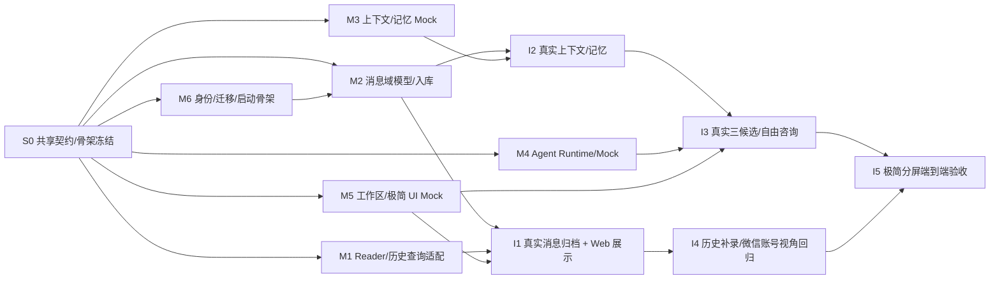

# 六模块开发顺序与并行协作计划

> 版本：v1.0 设计建议；以已接受的总体架构、六份模块设计和 `00_Shared_Contracts.md` 为依据。  
> 开发组织：**先冻结关键契约 → 分轨并行 → 按业务纵切联调**。  
> 完成状态：此文档为开发计划，不意味着任务已经开发、集成或验收。

## 1. 结论：能并行，但不能独立到互不协调

不用等六份模块全部“写完、实现完”再开始联调。分清两种依赖：

- **语义依赖**：跨模块 DTO、会话身份、数据所有权、状态与版本模型，必须先定（S0）。
- **运行依赖**：前端需要 AI 结果、Agent 需要上下文、M1 需要 M2 入库等；可以先通过 Mock / contract fixture 解耦，后续再接真服务。

推荐 **4 条开发轨道**，并允许六名 Agent 在独立分支/工作目录内同时开展子任务。对个人项目不必保持六个 Agent 24 小时同时工作；在有依赖和冲突的环节适当收敛到一个集成人。

## 2. 依赖图（开发时）



注：图中 M2 的迁移执行依赖 M6 的**最低可用**数据库/认证骨架，不依赖 M6 全部运维特性。M3/M4/M5 的原型、合同测试可在 M2 真库完成前启动。

## 3. 四条并行轨道

| 轨道 | 负责模块 | S0/S1 即可启动 | 实际集成依赖 | 独立验收产物 |
|---|---|---|---|---|
| **A：微信数据** | M2（主）、M1（并行） | M2：账号/会话/消息模型、约束；M1：读取器字段透传、有界历史查询 | D01/D02 冻结、M6 DB 骨架；M1↔M2 ingestion 接口 | 真实新消息写入+旧历史对账，幂等、方向来源可查 |
| **B：AI 能力** | M3 + M4 | M3：上下文构建/人工记忆 Mock；M4：Runtime 抽象、三候选 Schema、咨询 Thread/Mock | M2 的消息查询接口、M3 真实工具、M6 凭据/执行隔离 | 授权会话三候选 + 多轮咨询；不串联系人 |
| **C：用户体验** | M5 | 工作区三栏/双栏视图、极简六元素、共享状态/Mock API | M2/M3/M4 的 OpenAPI/DTO；流式/任务状态、会话刷新事件 | 完整 HTML/前端 E2E，240px 分屏、点击复制、人设/换批 |
| **D：公共基座** | M6 | Web/ASP.NET Core/PostgreSQL 启动、认证、DTO 包、日志与错误规范 | 各模块迁移/状态上报的对接点 | 本地可部署的安全基础设施/迁移流程 |

建议角色划分：一名**合同/集成维护人**（可兼 M2 或 M6），对共享契约与迁移顺序负责；其它模块 Agent 只改自己负责的文件，跨模块变更通过接口提案而非直接改别人的实现。

## 4. 开发阶段、并行度及里程碑

### S0：关键契约和最小工程骨架（必须最先）

**目标：让六组开发知道同一条消息、同一个联系人、同一批建议到底是什么。**

| 交付物 | 负责人 | 其他模块如何并行 |
|---|---|---|
| D01/D02：`RawMessageEventV1` / `HistoryBatchV1` | M1 + M2 | M1 做来源适配；M2 做入库 Mock |
| D04：小 ID 待确认默认、互换预览/确认提交、version/namespace/幂等键 | M2 + M5 | M5 先 Mock 画 UI |
| D05/D06：M2 消息查询 + M3 ContextBundle/画像状态 | M2 + M3 + M4 | M3/M4 fixture 开发不等真库 |
| D07/D08/D09：建议批次/自由咨询 Thread | M4 + M5 | M5 页面可先有交互；M4 提供 FakeRuntime |
| D10：持久化后消息变更通知与 cursor | M2 + M5 + M6 | M5 先模拟断连重同步 |
| 基础登录/Reader 身份/错误包/数据库迁移方式 | M6 | M1/M2 按统一错误与身份主体实现 |

**S0 放行标准：** 共享 OpenAPI/DTO fixture 能被各模块编译/解析；同一个 `accountId + conversationId` 的范围规则明确；`wx4:` Golden fixture 字节一致；六个模块**不再各自维护互相冲突的消息 DTO**。这是需要集中协调的一个小阶段，不是把所有业务设计都锁死。

### S1：全面并行实现（不需要等待其他人先完成）

**轨道 A：** M2 建表、保留 POC 兼容数据、入库幂等、会话查询和 calibration；M1 改造读取器源字段、有界历史查询、ReaderStatus。

**轨道 B：** M3 记忆 CRUD、ContextBundle、身份确认门控、画像/自动长期记忆共用的 >5,000 字滑动窗口和状态、搜索 Mock/测试；M4 `IAgentRuntime`、MockRuntime、Skill/输出 Schema、咨询 Thread 模型，选一个可真实调用的运行时作适配候选。

**轨道 C：** M5 工作区聊天 + AI 侧栏、极简默认六元素、共享状态、复制、人设和换批行为，端到端使用 Fake API。

**轨道 D：** M6 认证、迁移流水线、受限本机 Reader 凭据、日志脱敏、Agent 隔离运行模板、开发启动说明。

**S1 放行标准：** 每个模块完成自身 unit/contract tests；能在 Mock 环境演示单模块业务。此时不要求真实 Agent/本机微信/Web 全部连通。

### S2：按业务链路纵切联调（不是六模块同时合并大爆炸）

| 联调门 | 参与者 | 最小演示/放行条件 | 阻塞原因 |
|---|---|---|---|
| **I1：实时数据链** | M6 + M1 + M2 + M5 | 真微信指定会话文本 → PostgreSQL 幂等 → Web 实时显示/断线补拉 | 账号/会话归属、D01/D10、鉴权 |
| **I2：记忆检索链** | M2 + M3 + M6 | 查询当前会话最近/旧消息、创建一条人工记忆、返回可追证据的 ContextBundle | M2 查询 API、M3 版本/授权 |
| **I3：AI 实用链** | M3 + M4 + M5 + M6 | 真模型/Agent 返回 3 条当前会话建议、换批；同联系人自由咨询两轮，跨联系人不串话 | D06/D07/D08/D09、Runtime 安全 |
| **I4：历史/校准/画像链** | M1 + M2 + M3 + M5 | 一个获准会话补录旧文本、同源重试不重复；小 ID 默认待确认，互换只改预览、确认才重投影并启动首次沉淀；确认新视角后旧派生内容失效、按新版本重建；>5,000 字窗口边界准确 | D02/D04、source identity、校准作用域、画像/记忆共用游标 |
| **I5：完整 UI 闭环** | M1–M6 | 工作区消息 + 咨询侧栏，极简 3 条可复制，人设/换批有效，用户手动在微信发送 | I1–I4 的最小版本完成 |

**I1 和 I2** 可部分并行；**I3** 在 I2 最小上下文可用时接入；**I4** 的历史读取能力可提前开发，正式归档依赖 M2；**I5** 是对用户体验的最终联测。

### S3：安全回归、文档交付与基础版发布

- 回归源字段保存与 `wx4:` 兼容：旧 POC 5/5 canary 对照原理的 Golden fixtures、重复投递、同文异 ID 两条分别保留；多 shard **未证实的部分进入 NeedsReview 而非默默合并**。
- 回归小 ID 默认与身份确认：待确认方向显式标注且不更新画像/自动记忆；互换只改预览，确认后只影响当前 scope、带版本与幂等键；画像加载与滑动窗口沉淀必须匹配已确认的 `calibrationVersion`。
- 回归联系人隔离：API 查询/Agent 工具/Consultation Thread/Web 异步结果均不串话。
- 回归“小屏先行”：极简默认六项，不出现发送按钮、复杂配置导航；极窄视口可操作，复制错误可恢复。
- 回归安全：未鉴权访问、Reader 和 Web 不同凭据、日志脱敏、Agent 无 Shell/全库读/微信发送权限。
- 导出启动手册、模块接口清单、迁移说明、已知限制、备份/恢复建议、剩余增强 backlog。

**基础版发布门槛：** 单账号+指定 Direct 会话，真实消息归档与查看；真实三条建议及工作区 AI 咨询；极简点击复制；历史按需补录限定文本范围；小 ID 待确认默认及“互换身份预览/确认身份提交”；首次画像/长期记忆沉淀门控、>5,000 字共享窗口和来源可追溯性；必要安全边界。复杂多会话监听、附件、全量补录/心理画像不是发布阻塞。

## 5. 代码/资源所有权，避免并行冲突

建议工程目录（只是协作边界，不要求立即大规模重构）：

```text
/src
  /Contracts                    # 共享 DTO / 类型 / 错误码（合同维护人审查）
  /WeChat.Reader                # M1 本机独立进程脚本与读取适配
  /WeChat.Ingestion             # M1 接入 API 薄层
  /Conversation                 # M2 账号/消息/校准/历史归档
  /Memory                       # M3 记忆/上下文与查询
  /Agent                        # M4 Runtime/Skill/Run/Batch/Thread
  /Web                          # M5 前端应用
  /Platform                     # M6 配置、鉴权、日志、运行状态
/tests
  /Contracts /Conversation /Acquisition /Memory /Agent /Web /Integration
/db/migrations                  # 单人协调合入，不允许多模块无序改动同一文件
```

这只是抽象目录建议；可优先保持现有 ASP.NET Core 项目形态，以命名空间和模块接口隔离，无需为了文件夹拆分重新搭六个可执行项目。

建议使用 Git 分支或 Worktree：`feature/m1-reader`、`feature/m2-message`、`feature/m3-memory`、`feature/m4-agent`、`feature/m5-web`、`feature/m6-platform`；每条分支只维护自己的模块与测试。公共 DTO 更改先通过 `contracts/change-*` 小 PR，经影响模块共同评审。避免 Agent 为完成自己的任务顺手改写其它模块代码。

## 6. 必须统一的 8 个联合评审点

| 联合评审 | 牵头 | 参加 | 为什么要提前锁定 |
|---|---|---|---|
| R01：账号/会话身份键 | M2 | M1、M3、M5 | 防止联系人串数据 |
| R02：`RawMessageEventV1` 源字段 | M1/M2 | M6 | 历史/实时可合并 |
| R03：来源键与 shard 冲突处理 | M2 | M1 | 现有 `wx4:` 仅在单 shard 样本验证 |
| R04：`SenderCalibration` namespace/version | M2 | M1、M3、M5 | 视角选择不能误改其它身份范围 |
| R05：ContextBundle/evidence | M3 | M2、M4 | Agent 不读全库，记忆可追证 |
| R06：SuggestionBatch/persona/batchId | M4 | M5 | 真换批、跨模式共享、不可串联系人 |
| R07：Agent Thread / 工具权限 | M4 | M3、M5、M6 | 多轮咨询绑定联系人且不提权 |
| R08：认证/异步状态/事件 | M6 | M1、M2、M4、M5 | 浏览器恢复和隐私保护 |

## 7. 给开发 Agent 的最小任务协议

每个开发任务应包含：输入文档（总体+共享契约+自己模块）、允许修改目录、依赖 Mock/接口、预期输出、测试命令、非目标、验收样例。Agent 实施时应先报告它发现的**与合同不一致之处**，不能暗自更改 DTO；在需要跨模块修改时提交请求，由合同维护人协调。

推荐为每个 Agent 使用如下任务头（按模块替换）：

```text
你是 Mx 模块的开发 Agent。
基础输入：Overall Architecture + Shared Contracts v1 + Mx Design。
只能修改你负责的模块、相关测试及获批的迁移文件。
先根据既有仓库布局拟定最小改动清单；优先复用已验证 POC。
缺少其它模块功能时使用共享 DTO Mock，不擅自改其它模块。
不新增微信自动发送能力；不输出真实聊天正文或凭据。
交付：变更清单、接口说明、测试结果、未解决依赖和风险。
若共享契约冲突，停止受影响部分并提出合同变更申请。
```

## 8. 最小依赖矩阵

记号：**C** = 必须先确认合同；**M** = 可以用 Mock 开发；**R** = 真正联调时需要运行中的真实实现。

| 开发模块 | M1 | M2 | M3 | M4 | M5 | M6 |
|---|---|---|---|---|---|---|
| **M1** | — | C/M；最终 R | — | — | — | C/M；最终 R |
| **M2** | C/M；最终 R | — | — | — | C/M（校准和事件） | C；最终 R |
| **M3** | — | C/M；最终 R | — | C/M | — | C；最终 R |
| **M4** | — | 经 M3 | C/M；最终 R | — | C/M | C；最终 R |
| **M5** | 状态通过 API | C/M；最终 R | C/M；最终 R | C/M；最终 R | — | C/M；最终 R |
| **M6** | 状态合同 | 迁移合同 | 迁移合同 | 隔离合同 | 鉴权合同 | — |

## 9. 风险登记与是否阻塞

| 风险 | 已知事实或边界 | 当前策略 | 是否阻塞首版 |
|---|---|---|---|
| 微信版本兼容 | 只在当前测试版本有实证 | 读取异常显式报告；不宣称全版本可用 | 否（当前本机版本） |
| 跨 shard 消息键 | 5/5 canary 都来自单 shard | 存全来源 ID，冲突需审核；多 shard 后续验证 | 否（限定范围） |
| 自发/对方方向 | POC 仅证明精确范围校准；实测不同账号中小 ID 角色不同 | 每个有效范围小 ID 待确认默认；互换仅预览、确认才提交；画像/自动记忆确认门控 | 否（首版实现预览与确认） |
| Runtime 选型 | Codex CLI 候选，效果尚未证实 | IAgentRuntime 可替换、Fake + 至少一个真 Runtime | 否（不锁框架） |
| 多会话同时采集 | 未验证 | Selected 与 ActiveCaptureTarget 分离 | 否 |
| 画像归属与沉淀 | 默认 ID 可能反向；不同视角会改变消息归属 | 互换仅预览，确认前不更新；首次确认立即沉淀，此后画像/自动记忆共用 >5,000 字增量窗口，确认新视角后重建 | 是（需 D04/D06 一致） |
| 远程服务 | 当前本机 POC，不宣称远程已验证 | 首版本机受控部署、以后再迁移 | 否 |

## 10. 最终推荐实施顺序（一句话版）

**S0 冻结 D01/D02/D04/D06/D07/D08/D09/D10 → S1 六模块按四轨并行且大量采用 Mock → S2 依次打通真实数据链、上下文链、AI 链、历史与校准链 → S3 极简分屏完整体验与安全回归。**

其中第一优先开发 **M2 最小数据模型 + M6 运行骨架**；与此同时立即开始 **M1 读取器适配、M3 上下文与记忆 Mock、M4 Agent Runtime/Skill、M5 两模式前端**。真正的瓶颈是跨模块契约和最终集成，不是能否同时写六份代码。
