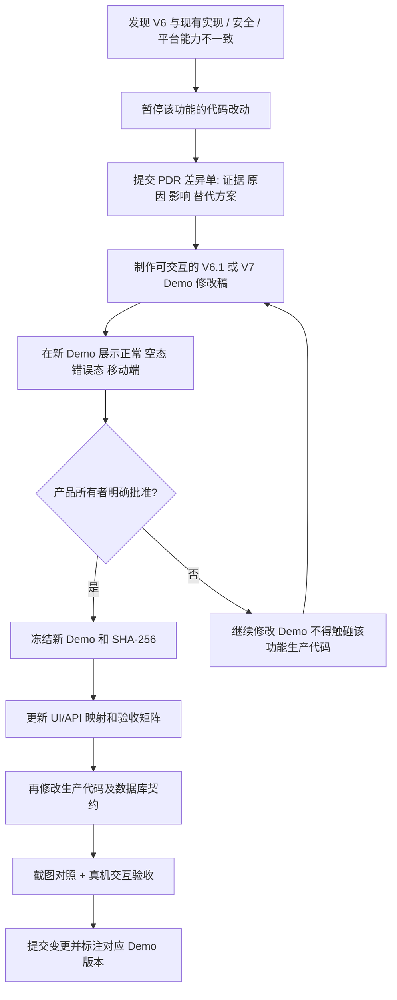

# 知间（WeChat AI Copilot）V6 前端严格实现与变更管控指导书

> **文档用途**：交给开发 Agent、前端开发者、后端开发者和集成负责人执行的**产品实现约束与验收依据**。  
> **状态**：实施指导草案；V6 作为当前唯一候选产品原型，最终冻结须由产品所有者确认。  
> **基准原型**：`WeChat_AI_Copilot_Product_Prototype_V6.html`  
> **原型 SHA-256**：`b82c6564b74ddc3a982b4d35e47b7d8ab11684b0fbca7e61223291fa05b243ac`  
> **代码参考基线**：GitHub `lan257/WeChat_AI_Copilot`，已审阅的 `main@5ecf5bbcacbe3cde57f0e9172f447d3e766688be`（2026-10-13）。执行时必须重新核实工作区 HEAD、未提交变更和实际运行版本。  
> **优先级**：本文件及**用户最后明确批准的 Demo**优先于旧的模块设计、Agent 自行推测、现有 UI 代码组织和开发便利性。数据库安全、隐私和微信只读边界为不可突破的基础约束。  
> **一句话目标**：让正式程序严格呈现并运行用户批准的 V6 产品流程；**代码适配已批准的 Demo，而不是 Demo 迎合现有代码**。

---

## 0. 不得误解的执行指令（最高优先级）

1. **产品原型是界面与交互的唯一权威**。页面结构、入口位置、文案含义、显示层级、打开与返回路径、交互顺序、响应式布局、状态反馈，按当前批准的 V6 Demo 实现；不得自行换成“管理后台布局”，不得擅自简化或删改用户可见功能。
2. **遇到实现与 Demo 不符，先停在该功能边界**。开发者先提交书面的差异说明、原因、受影响的用户流程与备选方案；**不得先改生产代码再要求用户接受**。
3. **先改 Demo，再审批，再改正式代码**。只有经产品所有者明确审核通过新版 Demo 后，才允许将相应差异同步到正式应用。未经批准的实现必须撤回、隐藏于未合并分支，不能当作“临时已完成”。
4. **新功能、新入口、新提示、新设置项同样遵循以上流程**。不允许因为发现后端已有一个能力，便在页面空白处补一张卡片或添加按钮。
5. **不以技术性测试冒充产品验收**。`dotnet test`、JS 语法检查、HTTP 200、单纯无横向溢出均是必要但不充分条件；必须真实浏览器点击、截图、用户路径回放及后端集成证明。
6. **原型模拟 ≠ 正式功能已实现**。Demo 内的假账号、模拟消息、模拟 AI、模拟连接/补录/画像操作，仅定义预期交互；上线版本必须由真实授权范围内的数据和服务支撑，不得保留“模拟成功”的假按钮与假状态冒充真实能力。
7. **实现自由仅限内部技术**。可以使用 Vue 3 + TypeScript + Vite、组件库或其他可维护方案；不可改变用户看到的已批准布局、操作或业务语义。继续使用 ASP.NET Core 10 / PostgreSQL / Windows Reader 原有后端是优先路径；后端模块无需为“重做 UI”被整体推倒。
8. **硬安全边界保持**：只读读取微信、不自动发送或代发；账号、联系人、消息、记忆、Agent 任务和 Skill 作用域必须被服务端强制隔离；不得把原始聊天、密钥、模型完整提示词默认写入日志；不能以 Skill 文本授予 Shell、任意文件、跨会话、网络或微信发送权限。
9. **批准主体只有产品所有者**。开发 Agent 的“自审通过”、子 Agent 评审、截图自动对比结果不能代替用户批准。

**强制判定**：出现“已完成，但界面跟 Demo 略有不同”“功能存在，只是入口换了”“先按现有后端做，之后再改原型”等表述，直接判定该项 **不合格 / 未完成**。

---

## 1. 基线管理：何为“严格按照 Demo”

### 1.1 必须在仓库中建立可追溯的产品基线

建议由集成负责人建立：

```text
docs/product/
  approved/
    V6/
      WeChat_AI_Copilot_Product_Prototype_V6.html
      screenshots/
      APPROVAL.md                   # 用户确认记录；未确认标记 PENDING
      SHA256SUMS.txt
  changes/
    PDR-0001-*.md                  # 每一项产品差异申请
  acceptance/
    V6_UI_Matrix.md                # 本文第 9 节派生的执行矩阵
    V6_Real_Flow_Report.md         # 真机验收证据
```

原型必须完整复制，不得悄悄改动原文件。先校验 SHA-256；若不一致，停止引用此基线并报告差异。**用户确认后将这份快照标成 Approved；之后哪怕只有一个按钮文案或间距发生产品性变化，也通过变更单产生 V6.1 / V7，不原地覆盖 Approved 文件。**

### 1.2 三类符合性

| 层级 | “一致”的意思 | 可以内部自由替换的内容 | 不能擅自改的内容 |
|---|---|---|---|
| **视觉一致（UI）** | 结构、层级、相对尺寸、色彩、间距、字体、头像、卡片样式、宽窄屏展示方式与批准 Demo 对齐 | 组件拆分方式、CSS 工程组织 | 将三栏改双栏、将侧抽屉改整页、缩到 8px、把状态卡占据主屏 |
| **交互一致（UX）** | 相同入口触发同一行为；空/加载/完成/错误/切换/返回/取消反馈符合 Demo | 事件框架、状态库、API 封装 | 点击“人设自定义”跳别的页、切联系人清空其他会话数据、把换批做成不可见动作 |
| **业务真实（Integration）** | 将 Demo 的模拟数据和计时改成真实 Reader、数据库、Agent、画像、Skill 及任务服务 | API、数据库、消息推送与后台作业实现细节 | 虚构回复或监听结果、静态假状态、客户端自行授权、无法恢复的进度 |

**注意**：像“模拟新消息”“模拟检测”“模拟 AI 起草”“演示账号”“演示完成”这类**原型专用元素**，不能原样当成正常应用功能，也不能擅自删除。必须在差异申请中明确其正式等价交互（如真实消息事件取代“模拟新消息”），**先由更新后的 Demo 表现该正式交互并获审批**，再修改产品实现。

### 1.3 项目不能只有一个“完成”状态

每个能力必须按下列状态跟踪：

`未设计 → Demo 已明确 → Demo 已审批 → UI 已实现（模拟契约）→ 后端已接入 → 真机验收通过`

任何能力如果停在“UI 已实现”，禁止在开发报告写“功能完成”。前后端并行阶段可另标记 `blocked: 缺少 API`，不能用 Fake 响应掩盖。

---

## 2. 产品信息架构：V6 确认的页面与入口

### 2.1 一级工作区只有三块

**左：微信账号 / 会话列表**  
- 显示当前账号、已连接/离线；支持切换账号、搜索联系人、全部/监听中筛选、监听标记、未读变化和最近消息信息。  
- 选择联系人只切换**当前查看会话**，不修改后台监听集合；不可擅自将“切换会话”实现为 Reader 重启。  
- 当前活动账号、历史离线账号和联系人目录须有明确状态；不能把 Demo 的两账号样例误认为当前 Reader 已具备多账号同时实时采集能力。

**中：聊天与 AI 回复建议**  
- 顶栏展示联系人、只读/监听/身份状态，点击头像或“人物画像”能打开画像抽屉。  
- 消息记录按真实发送方向绘制气泡；聊天列表**在固定工作区内独立纵向滚动**，支持按需载入更早消息和保持阅读位置。  
- 回复建议区域固定可达：一个人设选择器、旁边「自定义」入口、思考强度选择、生成/换一批/取消、三条可点击复制建议、加载/过期/失败反馈。  
- 不能为了塞入设置项挤压消息阅读区；建议区域内容多时必须明确内部滚动策略。

**右：AI 自由咨询**  
- 独立的连续咨询历史；针对当前联系人带上下文提问、Quick/Balanced/Deep/Max 独立档位、等待及错误状态、输入框固定底部。  
- 与建议生成共享当前会话，但**不是共享同一段任务状态**；切联系人不能混入上一联系人咨询、记忆或建议。  
- 窄屏下可切换为独立 AI 面板，不允许简单把三列压到不可读的宽度。

### 2.2 独立极简模式

按 V6 的单独界面实现，不是缩小的工作区。主视图保留：

- 「展开」入口；
- 当前联系人与状态（以尽量克制的方式）；
- **恰好三条**建议卡，点击复制；
- 一键切换人设、换一批；
- 必要时显示一行加载/建议过期/错误信息。

展开区允许返回工作区或切换联系人。极简必须适应手机分屏窄视口；**不能用 8px 正文、隐藏建议内容或裁切按钮**换取无横向溢出。

### 2.3 管理与详情采用次级抽屉

V6 左侧抽屉标签及语义保持：

| 标签 | 产品职责 | 主要入口 |
|---|---|---|
| 总览 | 当前账号、会话、监听与使用状态汇总 | 顶栏“管理” |
| 监听管理 | 对当前账号选择后台持续监听目标 | 会话栏“管理”、抽屉 |
| 会话详情 | 当前联系人的会话范围和关联操作 | 当前会话菜单 |
| 人物画像 | 关系背景、话题、计划、偏好、证据边界与纠错 | 联系人头像/人物画像按钮 |
| 我的表达 | 当前微信账号的自身沟通习惯和边界 | 账号菜单/管理 |
| 记忆与证据 | 记忆条目、证据、人工备注与删除 | 画像“查看证据” |
| 身份校准 | 本人/对方确认与必要时互换，更新校准版本 | 会话详情/身份提示 |
| 历史补录 | 范围选择、进度、幂等合并及结果 | 当前会话详情 |
| 人设与 Skills | 自定义人设、流程 Skill、AI 起草、管理与生命周期 | 人设旁“自定义”、管理 |
| 连接与配置 | 首次向导、诊断、引导与高级选项 | 顶部“连接设置”、管理 |
| 使用偏好 | 消息提示、预生成、快速模型路由等 | 管理 |
| 运行状态 | 能否使用、失败原因、恢复入口 | 管理 |

**禁止**把这十二项再次铺到日常聊天首屏。图形细节按 V6，功能归属按上述表。

---

## 3. V6 交互逐项落地清单（不得随意挪动）

### 3.1 账号、会话与监听：不同概念、不同状态

`当前活动微信账号`、`可见账号目录`、`当前查看会话`、`后台监听会话集合` 是四个概念。

必须满足：

- 账号选择只作用于账号空间；历史已知但当前未登录的账号允许浏览历史资料，**不能伪装为正在采集**；多账号同时连接若底层不支持，需按变更流程确定未连接状态与未来入口。
- 左侧搜索/过滤不影响监听订阅。
- A 和 B 同时监听时，从 A 切到 B、在 B 咨询或改人设，A 的监听不能停止；切回 A 后应看见其间真实收到的新消息。
- 新会话应经用户显式选择监听目标，不自动订阅所有联系人；选择查看 ≠ 选择监听。
- 监听启停必须以服务器确认生效为准，失败时回滚显示并说明原因。心跳超时、目标未注册、微信客户端离线分别区分。
- 有效账号和会话的 ID 只能由服务端校验；不允许仅靠前端切换下拉框防止跨会话越权。

### 3.2 聊天记录、身份与历史

- 聊天文本只读展示，不提供微信自动发送接口。
- 显示方向待确认时，按 Demo 提示用户校准；不会因 UI 把气泡画在左/右就将默认方向认定为可靠事实。
- 身份校准按账号/会话/具体来源身份命名空间约束，必要时“确认当前方向”或“互换并确认”；后台保存成功才更新页面与相关记忆版本。
- 历史翻页需去重、维持滚动锚点；新消息到达时若用户正在浏览旧消息，不强制跳到底部。
- 通过会话内“历史补录”提交真实范围任务，显示扫描数、匹配数、新建数、NeedsReview/失败数和状态；不能用计数器动画冒充补录。若当前仅支持单次 5,000 条且纯文本，如实显示上限与覆盖状态 Unknown。

### 3.3 三条回复建议和咨询

- 点击生成之后立即显示任务已受理状态；不能让浏览器长时间“没反应”。任务运行可取消；如后端仅支持同步 API，应先以后台任务适配层改造后再验收此功能。
- 生成结果固定三条、非空、可复制，均严格绑定 `accountId + conversationId + messageSetRevision + calibrationVersion + personaSkillRevision + workflowSkillRevisions + executionProfile` 等版本信息（可用等价的服务端签名/版本体系）。
- 新消息、会话身份校准、选用人设变更、适用 Skill 修改等发生后，旧建议**可供查看，但必须标记“已过期/需更新”**，不能表现为仍适配当前聊天的新建议。
- 复制成功/失败有明确反馈；复制只影响本机剪贴板，绝不调用微信发送。
- 会话 A 和 B 的建议、任务状态、咨询历史互相隔离。切换时延续或取消任务取决于真实任务策略，但不能将 A 的结果插到 B 页面。
- AI 咨询允许连续多轮，回复可以引用被授权的证据；缺乏证据时显示不确定性，不能杜撰对方意图。
- **思考档位与人设/Skill 是三个独立维度**。Quick 不读取宽泛历史且应优先低延迟；Balanced 结合近况与记忆；Deep 扩展检索；Max 增加有界检索及建议复核。档位是预算/路由策略，不授予额外数据访问权。
- V6 极简模式默认 Quick。禁止仅将超时延长、降低字数却仍花两分钟，就将其标为“快速已完成”；实际耗时与目标须实测并报告，达不到时标记未验收。

### 3.4 联系人画像、我的表达、记忆

- **人物画像**是联系人视角下的上层摘要，不是把 `memory_items` 原样列出。按照 Demo 分为概览、共同话题、近期计划、表达/互动偏好、推断边界、更新入口、查看证据、纠正/补充信息。
- **我的表达**按微信账号保存默认语气、沟通边界与个性化备注；与联系人画像分离。
- 事实证据、用户明确备注、模型推断**视觉上和数据上分开**。每个可核实主张应有来源、时间及校准版本；证据不足时显示“暂无可靠资料”，不能为排版填满虚构画像。
- 自动画像/记忆更新必须显示真实进度、结果及修订可追溯性；身份未确认时限制涉及方向归属的强推断。
- 人工纠错不能直接“改写历史事实”；使用备注/覆盖规则、来源链接与版本管理，允许撤回或修订。

### 3.5 首次配置与连接中心

按 V6 的 **四步连接向导**呈现，作为需要时进入的设置页面，不是日常进站必经的开发者控制台：

1. **本机应用与数据**：检测本机服务、数据库准备、迁移与存储权限。
2. **微信及只读 Reader**：检测客户端登录、授权账号、会话目录发现、目标监听与心跳。
3. **Codex / AI 提供方**：检测客户端/执行器、模型认证、可用模型、执行超时与连接测试；首次测试不得发送真实私聊正文。
4. **手机安全访问**：引导 HTTPS 安全配对、设备管理与撤销；可跳过，不阻塞电脑使用。

必须遵循：

- 普通用户不手动复制 Web Bearer Token，尤其不应每次刷新粘贴；本机可信会话由应用安全建立，跨设备使用独立短期可撤销会话；Reader ↔ API 继续用内部机器凭据。CSRF、恶意本地网页访问与设备信任问题必须评估。
- PostgreSQL 私有实例原则上由应用管理：初始化、迁移、状态、备份/恢复；外部 PG DSN、管理员凭据、代理、CLI 路径仅在专家设置中受控使用，前端不直接连接数据库。
- Reader 应由应用管理启停、状态与故障恢复，不要求用户每天在终端跑 Python；微信登录与授权仍由用户完成。
- “检测通过”必须来自真实检查；出错展示“什么不能用、为什么、怎么处理、重试入口”，不能简单展示一篇环境配置教程。
- 保留真实连接限制：当前 Windows 微信活跃账号与多账号同时在线并非同一能力；手机 LAN HTTPS 配对若尚未实现，状态为“尚未启用”，不允许展示可用链接。

---

## 4. 人设就是 Skill：V6 功能合同

### 4.1 通用 Skill 模型（拟议正式实现契约，不假称现有后端已具备）

至少持久化或等价表达以下字段：

| 字段 | 用途 |
|---|---|
| `skillId`、`type` | 唯一身份；`Persona` 或 `Workflow` |
| `name`、`description`、`instruction` | 名称、简述、用户自然语言规则；禁止任意可执行脚本 |
| `stages[]` | 只能从下方六个系统固定阶段选择，不允许自由注入 Hook 名称 |
| `scopeType`、`accountId`、`conversationId?` | 所有已授权账号 / 当前账号 / 单联系人；服务端强校验 |
| `enabled`、`builtIn`、`origin` | 启停、系统模板/个人自定义、手写/AI 辅助 |
| `revision`、`createdAt`、`updatedAt` | 版本、追踪、恢复、候选失效 |
| `approvalStatus`、`approvedAt?` | AI 草稿不能直接启用；保存确认与审批状态明确 |
| `lastValidation?`、`lastRun?` | 可选：执行审查结果与最近使用阶段（不得含私聊日志） |

**模型归属**：系统模板可以“复制定制”，不修改内置 Skill 本体；自定义 Skill 可编辑、停用、删除/软删与恢复历史版本。正式存储不能仅依赖浏览器内存。

### 4.2 六个固定生命周期（原型对应名称）

| 内部阶段建议 ID | Demo 名称 | 可执行行为边界 |
|---|---|---|
| `message` | 新消息到达 | 标记变化、安排轻量工作；不自动发送 |
| `context` | 构建上下文 | 在授权范围内决定检索重点与截断条件 |
| `reply` | 生成回复前 | 应用一个所选人设 + 多个适用流程 Skill |
| `review` | 回复生成后 | 检查事实、来源、语气与承诺；必要时要求修订 |
| `consult` | AI 咨询前 | 调整分析关注点，允许受控历史检索 |
| `memory` | 记忆沉淀前 | 产生待验证记忆候选；不自行写入强事实记忆 |

**调度顺序由可信应用控制**。Skill 本身不能修改生命周期执行顺序，不可自定义可执行回调，不可获取额外工具权限。多流程 Skill 的优先级、冲突处置和失败策略必须在服务端定义并可审计；若改变 Demo 用户可见选择或行为，走产品变更审核。

### 4.3 选择、组合、作用域

- 每个会话当前选定**一个人设 Skill**；适用且启用的流程 Skill 可以叠加多项。
- 默认提供原型中的系统人设样例：`自然`、`温柔`、`俏皮`、`简洁`，但它们**不是锁死的可选列表**；用户可以自己创建“克制的温柔”等。不要将“温柔”仅映射到一个硬编码 Prompt 形容词。
- 用户可复制系统人设→编辑名称/说明/具体行为规则→选择生命周期和适用范围→预览→确认保存并启用→在当前联系人中使用。
- 范围选择按 Demo 包含“当前微信账号所有联系人 / 仅当前联系人 / 所有已授权账号”；服务端必须验证范围并在会话切换后重新计算可选列表。
- 修改、停用或删除已生效 Skill 后，受影响会话的建议应标记过期；后续运行固定使用已批准的版本，避免中途被篡改。

### 4.4 AI 辅助创建

`描述需求 → AI 产出可编辑草稿 → 用户编辑规则 / 作用域 / 阶段 → 执行预览 → 显式保存并启用`

- 原型中的“AI 起草”是规则模拟；正式版调用真实模型、对输出进行结构化验证与安全审查，**先产生 Draft**，不自动启用、不自行修改系统模板。
- 编辑器原型具备类型、名称、一句话说明、自然语言规则、作用域、六阶段勾选和预览。不可省略这些控件，也不能由模型替用户默许勾选危险权限。
- 原型基本校验：名称非空且不超过 34 字、规则不少于 8 字、必须选至少一个阶段、回复人设必须包含“生成回复前”；正式版可以加入更严格的安全校验，但**若用户可见输入上限/提示变动，先修订 Demo 并获批**。
- 预览需要说明会影响哪些阶段、何种上下文和可能变化；正式版可使用脱敏/授权测试数据给出差异，不能假装模型真的执行过。
- 版本、审计与回滚是正式业务保障，不得用“保存到 JS 数组”替代。

### 4.5 记忆、模型和 Skill 的边界

- `我的表达` = 长期的本人偏好与边界；`联系人画像` = 他/她的有来源背景；`人设 Skill` = 本轮希望如何说；`流程 Skill` = 哪个阶段执行哪种约束；`思考强度` = 模型路由、上下文及工作预算。
- 这五者不可折叠成一个巨大 Prompt 字段或一个混杂配置页面。
- 用户自然语言 Skill 只是**不可信指令数据**，不能覆盖服务端安全规则、账号范围、系统消息和用户明确授权。

---

## 5. UI 状态模型与必要异常路径

各页面至少应覆盖以下状态，并使用 Demo 的现有卡片、提示与布局槽位呈现。**需要新状态 UI 时，先走 Demo 更新审核。**

| 业务 | 必测状态 | 禁止行为 |
|---|---|---|
| 账号 | 已连接、离线、未发现、认证失效、切换中 | 将离线账号显示为正在监听 |
| 会话 | 无联系人、搜索无结果、未监听、监听中、有未读、读取失败 | 切换会话重启所有监听、旧会话数据串入新会话 |
| 消息 | 加载、正常、加载更早、读取失败、消息修订变化、身份待确认 | 自动滚动打断阅读、默认方向冒充已确认 |
| 建议 | 尚未生成、排队/运行、生成中阶段、成功三条、已过期、取消中、失败/可重试 | 卡死无反馈、任务返回后覆盖了已切换的联系人 |
| 咨询 | 空对话、上下文可用/不足、运行、取消/超时、完成、引用证据失效 | 跨账号恢复同一个 thread 或显示不属于当前会话证据 |
| 画像 | 没证据、部分证据、身份未确认、生成中、已更新、纠错、版本过期 | 缺乏证据仍生成确定性人身判断 |
| Skill | 列表空/非空、适用/不适用、草稿、编辑未保存、AI 起草、预览、保存中、冲突、成功、停用、失效 | AI 草稿自动启用、直接执行自然语言当代码 |
| 连接 | 未安装、未登录、未授权、检测中、可用、降级、失败、恢复/重试 | 展示虚假绿色状态、复制原始 Token 作为日常登录 |
| 历史补录 | 未开始、排队、运行、部分、完成、失败、取消、NeedsReview | 只写“完成”却不展示覆盖范围与冲突 |

**错误文案原则**：用户先看到可理解的原因和下一步；原始异常栈、内部路径、账号 ID、凭据、完整聊天正文仅在必要且经过脱敏的诊断里处理。

---

## 6. 实现架构及各模块责任（不重新规定视觉）

建议前端目标仍为 **Vue 3 + TypeScript + Vite**。允许其它方案，但必须提供等价的状态分离和测试，不得再把所有状态塞回巨大的单文件脚本。

```text
AppShell
 ├─ TopBar / AccountSwitcher
 ├─ ConversationSidebar / ConversationSearch / MonitorIndicator
 ├─ ChatWorkspace
 │   ├─ ConversationHeader / PortraitShortcut / IdentityWarning
 │   ├─ ChatTimeline / HistoryPagination
 │   └─ SuggestionDock / PersonaSkillSelector / ProfileSelector / SuggestionCards
 ├─ ConsultationPanel / ConsultationHistory / Composer
 ├─ FocusMode
 └─ DetailDrawer
     ├─ Overview / Listening / ConversationDetail
     ├─ ContactPortrait / MyExpression / MemoryEvidence / IdentityCalibration
     ├─ HistoryBackfill
     ├─ SkillCenter / SkillEditor / SkillAiDraft / SkillPreview
     ├─ ConnectionWizard / Preferences / RuntimeStatus
```

建议状态按 `auth + accounts + activeConversation + monitoringTargets + messages + suggestionsByScope + consultationsByScope + portraits + skills + setup` 分仓。状态中心**只保存领域真相**，界面组件不自行改变授权关系或构建可信证据。

### 6.1 模块交付映射

| 原模块 | 为 V6 提供什么 | 不得承担什么 |
|---|---|---|
| M1 只读 Reader | 本机账号状态、会话发现、多个显式监听目标、心跳与历史读取 | UI 结构决策、自动发送、未授权扫描 |
| M2 账号消息 | 账号/会话目录、按范围查询、消息版本、身份校准、历史归并 | 用全局 sender ID 猜测方向 |
| M3 记忆上下文 | 记忆证据、联系人画像、本人表达、上下文与失效追踪 | 编造无证据人格描述、跨会话共用私密记忆 |
| M4 Agent | 人设/Skill 存储和执行、档位路由、建议/咨询、异步运行和结果审查 | 直接读取任意会话或执行 Skill 脚本 |
| M5 前端 | 精准复现批准 Demo 的视觉、交互和所有状态 | 自行重新设计入口、用客户端校验代替服务器授权 |
| M6 平台 | 安装/运行、配对认证、连接向导的诊断 API、配置保护、迁移、备份与状态 | 让普通用户重复操作 Token、数据库密码和编译器 |

### 6.2 API 合同：先映射，再开发

**以下是需要评审/补齐的能力类别，不代表仓库现有全部接口已经实现**：

- `Accounts/Conversations`：账号目录、可用性与联系人列表；当前查看范围独立于监听目标。
- `Monitoring`：目标增删、版本冲突处理、按目标状态和心跳、动态调整结果。
- `Messages`：按会话分页、增量游标/推送、方向校准版本、历史覆盖状态。
- `Portrait/Memory`：画像概览、区分事实和推断、证据查询、人工备注与变更版本。
- `Agent`：执行档位、每会话人设、建议任务创建/读取/取消/进度/恢复/失效、咨询线程与问答。
- `Skills`：列表、创建/编辑、模板复制、启停、版本、适用范围、AI 草稿、批准、预览和审计。
- `Operations`：连接诊断、只读微信状态、AI 提供方鉴权/可用性、私有 PostgreSQL 状态、手机配对和备份恢复。

先做 `UI 元素 → 用户意图 → 请求/事件 → 服务器校验 → 成功/失败状态` 的映射表；**现有 API 不适合交互时优先在服务层加适配接口，不能强迫产品改用不合适的交互。** 如果 API 的安全或平台限制确实要求改变用户路径，提交产品差异单。

---

## 7. 严格变更工作流：先更新 Demo，批准后才允许改代码

### 7.1 标准流水线（必须按顺序）



**不允许**：开发者修改了 API、组件、CSS 后才补写差异说明；也不允许将未批准的 UI 分支直接合入主干、要求用户“先试试”。

### 7.2 PDR 变更单模板（每个差异必须填写）

```markdown
# PDR-XXXX 产品原型差异申请
- 当前批准 Demo：V6，SHA-256：...
- 影响区域 / 入口：...
- V6 预期的可观察行为：...
- 实现现状（代码路径、复现步骤）：...
- 不一致类型：视觉 / 交互 / 安全 / 平台能力 / 性能 / 数据合同
- 为什么无法或不应按 V6 原样实现（附证据，不写“技术原因”四字）：...
- 方案 A：保持用户体验，调整后端/适配层；成本、风险：...
- 方案 B：需要用户批准的产品变化；用户影响与替代方案：...
- 新 Demo 文件及可交互操作位置：...
- 新旧 Demo 截图（1440/390/240）与差异说明：...
- 正常、空态、失败态、权限态：...
- 用户审批结论：待审 / 批准 / 拒绝；日期、批准范围：...
- **审批前代码状态**：未实施 / 已在独立试验分支且未合并
- 审批后生产 PR / 测试证据：...
```

**批准必须具体**：用户回复“批准 PDR-XXXX 的 Demo V6.1”，而不是 Agent 以“没有反对”推断通过。

### 7.3 典型情形的强制处理

| 情形 | 正确动作 | 错误动作 |
|---|---|---|
| Reader 暂时只支持一个正在登录的微信账号 | Demo 显示历史账号离线、解释连接限制；需改交互时提交 PDR | 删除账号选择器或伪造第二账号在线 |
| 真实 AI 无法在两秒内返回 | 先做任务进度、后台异步、缓存/路由；新加载交互先在 Demo 经审核 | 把等待时间隐藏、延长超时、显示假的已完成 |
| 当前只支持一对一文本历史 | Demo 标注实际覆盖和未支持范围，提供用户可理解提示 | 静默显示“全部历史已同步” |
| V6 的“模拟新消息”不是生产功能 | 提议用真实推送与调试入口替代，在 Demo V6.1 展示并请用户审 | 正式产品保留虚假模拟按钮或直接删除按钮不报备 |
| Skill 系统需要新权限说明 | 在 Demo 更新创建/预览/审批页面并先审批 | 开发者另加一个“高级技能脚本”页面 |
| 组件库无法复现批准的抽屉 | 更换组件或在新 Demo 提议改稿后征得审批 | 默默换成全屏页面并宣布实现 |
| 安全风险需要即时封堵 | 暂时禁用受影响功能，报告阻断原因；用户可见替代设计走 PDR | 以安全为名永久删除用户功能且不提交设计 |

---

## 8. 并行开发次序与交付门槛

**目标不是六个模块写完各自汇报，而是每次交付一条真实的用户路径。**

### G0 · 产品基线确认（所有开发前置）

- 核对 V6 HTML 哈希、演示行为、12 个抽屉标签、六阶段 Skill、桌面及窄屏截图。
- 用户明确确认“V6 作为当前实施基线”，或先按用户意见修改为 V6.1 再确认。
- 提交 **UI/API 追踪矩阵**和未实现能力清单，注明属于产品必要功能还是原型模拟。
- 未完成 G0 可以做代码阅读与契约研究，**不能据此擅自调整已定义 UI**。

### G1 · 前端精确复刻（轨道 F，首先演示）

- 使用独立 UI 分支和受控 Mock Adapter，将 V6 全页面、抽屉、响应式模式及交互状态组件化。
- 不连接真实账号也可以展示**明确标记为 Demo 的开发环境**；生产环境不得显示合成数据。
- 交付桌面、窄屏、横竖向和极简截图，并逐项演示 Skill 编辑器、画像和向导。
- 用户审核视觉/操作通过后再进入 G2，不允许用后端接口完成度要求跳过 UI 评审。

### G2 · 底层并行接入（轨道 D / A / O）

| 轨道 | 责任 | 前置依赖 | 交付 |
|---|---|---|---|
| **D：会话与采集** | M1 + M2 | 账号/会话/监听/消息契约确认 | 真实目录、2 会话持续监听、会话切换、历史分页与身份校准 |
| **A：AI / 画像 / Skills** | M3 + M4 | 会话作用域、任务与 Skill 契约确认 | 四档、真 AI 建议、异步任务、Skill 版本、画像证据与记忆 |
| **O：应用运行** | M6 | 认证/诊断/启动契约确认 | 普通用户启动、自动本机会话、连接向导、真实状态、备份恢复；手机安全配对在功能完整验收中不得遗漏 |
| **F：前端集成** | M5 | G1 UI 批准和接口 Mock 契约 | 换成真实 API Adapter，不改批准布局和流程 |

四轨道可并行，但**公共契约、数据库迁移、应用状态机由单一集成负责人维护**。每次跨模块变动先通知对应负责人；影响 UI 必须触发第 7 节审批。

### G3 · 真实使用闭环（集成验收）

逐个交付下列纵向功能切片：

1. PC 正常启动 + 自动授权 + 已登录微信账号 / 联系人目录。
2. 两个真实会话同时监听 + 工作区切换 + 实时消息更新。
3. 当前会话历史分页 + 身份校准 + 可追溯记忆/画像。
4. Quick 建议和复制 + 新消息失效 + 切换联系人不串数据。
5. Balanced/Deep/Max 咨询和有界复核 + 用户自定义 Skill 真正影响结果。
6. Skill 的 AI 草稿、编辑、保存、版本、启停、作用域与生命周期真实执行。
7. 连接中心真实诊断和故障恢复；手机 HTTPS 配对后极简分屏实际使用。

**只读微信，不自动发送**贯穿所有切片。

### G4 · 产品所有者验收与封版

- 用户浏览器实际操作通过；测试报告给可重复操作步骤、截图、视频（如有）、耗时和失败说明。
- 记录已审批 Demo 版本、实际代码提交、差异单与遗留缺口。
- **不能将“后端存在但 UI 尚未接入”“Demo 中能点击”计入已完成能力**。

---

## 9. 强制浏览器验收矩阵（建议全部过后才声称符合 V6）

每项证据至少记录：`Demo 版本/哈希`、`代码提交 SHA`、`测试环境`、`账号和会话（脱敏别名）`、`实际浏览器截图`、`操作结果`、`问题单`。

| ID | 用户操作 | 必须观察到的结果 | 最低证据 |
|---|---|---|---|
| UI-01 | 打开桌面 1440×900 工作区 | 会话、聊天+建议、AI 咨询三栏；主工作流优先；无模块配置占据主屏 | V6/正式版并排截图 |
| UI-02 | 1200×800、850×700 查看 | 随宽度重排而非挤压三栏；滚动合理 | 各宽度截图+滚动录像 |
| UI-03 | 手机 390×844 工作区 | 联系人/聊天/AI 可切换且字体可读 | 真机/浏览器截图 |
| UI-04 | 240×550 极简分屏 | 三条建议完整、复制触点可点、展开/人设/换批可操作，不横向溢出 | 点击录像与截图 |
| UI-05 | 聊天中有 200 条消息 | 消息区独立滚动；打开旧记录不被新事件拉到底部 | 录屏/滚动位置断言 |
| UI-06 | 切 A→B→A | 监听目标不变；消息/建议/咨询/画像/人设按范围恢复 | 两真实会话与日志摘要 |
| UI-07 | 同时监听 A、B | 未在查看的 B 收到新消息，列表状态更新且持久入库 | 真微信只读联调 |
| UI-08 | 方向待确认→确认/互换 | 提示清楚；方向和记忆版本生效；无错误归属泄漏 | 状态/版本和页面截图 |
| UI-09 | 生成人设为 Quick 的三条建议 | 立即有任务反馈，完成后三条可复制，返回真实运行记录 | 真 AI API+浏览器计时 |
| UI-10 | 建议生成中取消 / 失败重试 | 状态准确；迟到的取消任务结果不会污染当前页面 | 网络模拟+真实请求 |
| UI-11 | 新消息到达、改变人设、修改 Skill | 旧建议标记已过期、可见但不误称最新 | 浏览器截图+版本字段 |
| UI-12 | 连续咨询 30 轮并切换联系人 | 输入框位置稳定，历史可滚动，每会话独立；可找到证据 | 浏览器交互与作用域回归 |
| UI-13 | 打开联系人画像 | 概览/话题/计划/偏好/证据/纠错齐全；无证据显示空态 | 画像正常/空态截图 |
| UI-14 | 修改“我的表达” | 当前账号保存；不改变其他账号资料 | 持久化与切换验证 |
| UI-15 | 复制系统“温柔”→创建“克制的温柔” | 编辑类型/规则/范围/六阶段/预览/确认，选择器可用 | 完整点击录像 |
| UI-16 | AI 辅助创建流程 Skill | 先显示可编辑草稿；未经用户确认不能启用；可停用/回滚 | API 记录+浏览器截图 |
| UI-17 | 不同联系人启用不同 Skill | 不交叉生效；修改 Skill 后旧建议过期 | 服务端授权测试 |
| UI-18 | 历史补录与监听互不影响 | 进度、去重、新增、冲突显示真实结果 | Reader/PG 真联调 |
| UI-19 | 首次连接 4 步与再次进入 | 首次引导可用，日常不重复配置 Token；失败能重试 | 全流程录屏 |
| UI-20 | Codex 不可用 / 微信离线 / DB 异常 | 出错位置与恢复操作清晰；绝不显示假绿灯 | 故障注入截图 |
| UI-21 | 手机配对并打开极简模式 | 通过安全 HTTPS、设备授权；复制成功且不能越权 | 两设备人工验收 |
| UI-22 | 仿照 V6 打开/关闭管理抽屉并返回 | 不破坏当前聊天、焦点、滚动及未保存编辑；视觉层级一致 | 截图、键盘操作 |
| UI-23 | Skill 编辑中切页、失联、取消 | 草稿不静默丢失，提供保留/放弃等经审批交互 | 浏览器交互 |
| UI-24 | 审核跨会话、密钥和发送权限 | 无自动微信发送、无聊天日志泄露、无跨账号记忆、Skill 无提权 | 安全回归结果 |

**备注**：UI-23 的完整未保存草稿阻拦若当前 V6 未展示，须先通过 PDR 更新 Demo 再实现；同理手机配对真实确认界面在 Demo 不充分时，也必须先补原型。矩阵里的“必须具备的业务真实性”不能反过来授予 Agent 私自设计新页面的权限。

### 9.1 视觉对照规范

截图固定至少：`1440×900`、`1200×800`、`850×700`、`390×844`、`240×550`；必要时增加 320、375 宽和小高度屏。每个状态都要截屏。系统字体渲染可有自然差异，但**不能改变内容顺序、主列关系、卡片布局、按钮所在位置和可视/滚动策略**。

字体不能以“通过无溢出”为由缩到难以阅读；如果原型本身存在问题，**先请用户审批原型修复，再同步代码**。

### 9.2 性能与可用性验收

- 分别记录 `界面交互响应`、`检索`、`排队`、`模型/CLI`、`复核`、`完整建议耗时`，不得把 CLI 总时长当纯模型思考时长。
- Quick 的低延迟目标需要与用户单独确定**可测阈值**；在阈值未批准前，只能报告实测数据，不得声称“达标”。
- 任务运行较慢时不阻塞会话切换或阅读；新事件导致的旧结果失效必须可靠。
- 不能使用虚构性能数据、快进计时器或模拟完成结果证明真实能力。

---

## 10. 开发者 / 多 Agent 协作要求

**唯一产品负责人**：用户；**唯一集成负责人**：由用户指定的技术负责人；**各轨道开发 Agent**：可独立编码，不拥有改变产品原型的审批权。

每个 Agent 开始前必须：

1. 阅读已批准的 V6 HTML，并用浏览器实际执行负责区域的交互；不准仅凭旧文档理解 UI。
2. 核对 Git HEAD、未提交差异、受影响文件、迁移表、真实 API 状态。
3. 建立 `Demo 元素 ID/路径 ↔ UI 组件 ↔ API ↔ 测试 ID` 映射，列出尚未支撑的后台能力。
4. 按任务分支开发；禁止同时修改共享 DTO/迁移/UI 根布局，除非集成负责人协调。
5. 若发现差异：停止该项 → PDR → 修改可交互 Demo → 用户批准 → 才进入代码阶段。

每轮交付必须分成四段且带证据：

- **已按 Demo 复现**：列 UI 路径、截图、关键操作。
- **已与真实后端连接**：列真实数据/接口/范围，不含私聊正文或密钥。
- **尚未实现/无法验收**：清楚列缺口、原因和对应 PDR。
- **下一轮阻断与请求批准**：明确哪个 Demo 改动需要用户审核。

开发报告不得再用“全部 M1–M6 完成”“几百项测试通过”概括用户尚不能完成的主流程。

### 10.1 每个 Pull Request 的强制检查

- [ ] 明确指定所依据的批准 Demo 版本及 SHA。
- [ ] 若涉及用户可见变化，已附批准的 PDR；否则不得合并。
- [ ] Demo 和代码对照截图完整，特别是实际目标屏幕宽度。
- [ ] 正常/空态/加载/错误/离线/过期/取消状态已测试。
- [ ] 不是 Fake 数据冒充真实微信/AI 运行。
- [ ] 服务端权限与数据隔离覆盖跨账号、跨会话、跨 Skill 范围。
- [ ] 无自动发送微信、无敏感明文日志、无原始凭据外露。
- [ ] 旧功能回归通过（切换、历史、记忆、监听、极简和复制）。
- [ ] 有实际浏览器操作证据与必要的后端联调记录。

---

## 11. 正式开工指令（可直接粘贴给开发 Agent）

> 当前任务不是继续给旧 Demo 添加功能，而是严格实现**产品所有者已确认的 V6 产品交互原型**。先核验原型文件与 SHA，确认是否收到用户最终批准；没有批准时只做映射与方案，不擅自修改产品 UI。  
> 你必须把 V6 作为唯一用户可见行为基线，首先制作原型→正式页面的差异矩阵，并给出可验证的按阶段实施计划。视觉结构、布局、入口、文案含义、会话切换、人设与 Skill 编辑器、六阶段生命周期、画像、配置向导及极简分屏均严格复刻。  
> V6 所有模拟行为必须接入真实后端或明确标记尚未支持，绝不伪装真实完成；生产 UI 的任何改变（包括移除“模拟新消息”这种原型专用入口）均须先提交 PDR，解释原因，改出可交互的新 Demo，等待我明确审核通过后，才允许修改生产代码。  
> 允许重构前端内部架构与后端适配层，不能擅自改变用户体验。任何安全或底层限制必须先报告，而不是自行删除功能或换入口。  
> 第一轮只交付：**现有代码差距矩阵、UI/API 契约、可运行且与批准 Demo 对齐的前端、桌面与手机分屏截图、真实浏览器交互记录，以及需要我审批的差异单**。我确认界面后再推进全量业务联调。不要使用测试数量代替交付结果。

---

## 12. 最终验收定义

**“严格按 Demo 实现”** 不是复制 HTML 文件，也不是让按钮能点击；而是在真实数据、可持续运行、权限隔离与故障恢复的前提下，完整保留经用户批准的界面和交互。

正式验收必须同时成立：

- **看上去是 V6**：桌面与手机的主要结构、抽屉、极简及细节遵循已批准设计。
- **操作起来是 V6**：每个已设计的动作有相同入口和预期行为，不需要用户理解内部模块或 API。
- **后台是真实的**：微信只读消息、AI、记忆/画像、Skill、监听状态与连接状态均有真实来源；未实现的能力明确标记。
- **异常时像正常应用**：用户知道哪里出问题、如何恢复，不必复制 Token、手改数据库或打开开发终端。
- **差异均有批准**：所有偏离有 PDR 和**先改 Demo、经用户审批、后改代码**的完整记录。

满足全部内容方可标记为“正式产品功能验收通过”。任何一项未达到，报告应标明准确的阶段和缺口，不得声称整体完成。
